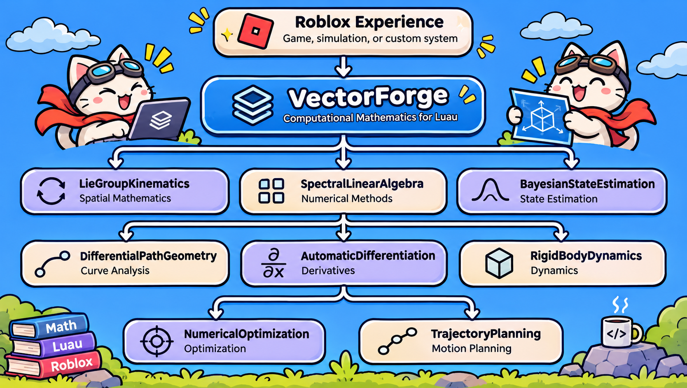

 <div align="center">

# VectorForge

### Advanced Computational Mathematics for Roblox Luau

**Explore numerical methods, geometric computation, and mathematical systems directly inside Roblox.**

VectorForge is an experimental Luau library exploring the implementation of advanced computational mathematics, including Lie group kinematics, numerical linear algebra, Bayesian state estimation, differential geometry, and more.

[](https://luau.org/)
[](https://www.roblox.com/)
[](LICENSE)
[](#project-status)

**[Quick Start](#quick-start) · [Core Modules](#core-modules) · [Examples](#examples) · [Experiments](#experiments) · [Simulations](#simulations) · [Datasets](#datasets) · [Visualizations](#visualizations) · [Documentation](#documentation)**

</div>

---

## Overview

Roblox provides a convenient environment for building interactive experiences, but some mathematical problems require more specialized numerical techniques.

VectorForge explores how these techniques can be implemented in Luau through a collection of independent mathematical modules.

The project covers concepts commonly found in numerical analysis, robotics, computational geometry, classical mechanics, probability, and optimization.

Rather than attempting to replace Roblox's built-in APIs, VectorForge focuses on mathematical operations that extend beyond conventional gameplay scripting.

**The goal is to make advanced mathematical techniques accessible, reusable, and open to experimentation within Roblox.**

## Quick Start

### Installation

You can install VectorForge manually or use the included Rojo project configuration.

**Manual installation**

1. Open Roblox Studio.
2. Navigate to `ReplicatedStorage`.
3. Create a folder named `VectorForge`.
4. Copy the ModuleScripts from `src/VectorForge/` into that folder.
5. Keep the original ModuleScript names.

Your Explorer hierarchy should look like this:

```text
ReplicatedStorage
└── VectorForge
    ├── LieGroupKinematics
    ├── SpectralLinearAlgebra
    ├── BayesianStateEstimation
    ├── DifferentialPathGeometry
    ├── AutomaticDifferentiation
    ├── RigidBodyDynamics
    ├── NumericalOptimization
    └── TrajectoryPlanning
```

### Rojo

VectorForge includes a Rojo project configuration.

Make sure `default.project.json` maps `src/VectorForge` to `ReplicatedStorage/VectorForge`.

Build the project:

```bash
rojo build default.project.json -o VectorForge.rbxlx
```

[Rojo documentation](https://rojo.space/)

### Basic usage

After installation, load the modules using Roblox's `require()` function.

```lua
local ReplicatedStorage = game:GetService("ReplicatedStorage")

local VectorForge = ReplicatedStorage:WaitForChild("VectorForge")

local Lie = require(VectorForge.LieGroupKinematics)
local LinearAlgebra = require(VectorForge.SpectralLinearAlgebra)
local StateEstimation = require(VectorForge.BayesianStateEstimation)
local PathGeometry = require(VectorForge.DifferentialPathGeometry)

local AutomaticDifferentiation =
    require(VectorForge.AutomaticDifferentiation)

local RigidBodyDynamics =
    require(VectorForge.RigidBodyDynamics)

local NumericalOptimization =
    require(VectorForge.NumericalOptimization)

local TrajectoryPlanning =
    require(VectorForge.TrajectoryPlanning)
```

Each module exposes its own functionality. Refer to the [API Reference](docs/API.md) for available operations, parameters, and return values.

---

## Core Modules

VectorForge currently explores eight mathematical domains.

| Module | Mathematical Domain | Main Focus |
|---|---|---|
| `LieGroupKinematics` | Lie Theory | Rotations and rigid transformations |
| `SpectralLinearAlgebra` | Linear Algebra | Matrix operations and numerical solvers |
| `BayesianStateEstimation` | Probability | State estimation and uncertainty |
| `DifferentialPathGeometry` | Differential Geometry | Curves, curvature, and path analysis |
| `AutomaticDifferentiation` | Numerical Calculus | Derivative propagation |
| `RigidBodyDynamics` | Classical Mechanics | Forces, torques, and rigid-body motion |
| `NumericalOptimization` | Optimization | Numerical minimization |
| `TrajectoryPlanning` | Motion Planning | Trajectory construction and evaluation |

### 1. LieGroupKinematics

**Lie Groups · Rotation Theory · Rigid-Body Kinematics**

Mathematical representations for rotations and rigid transformations in three-dimensional space.

Concepts explored:

- Quaternion algebra.
- SO(3) rotation operations.
- SE(3) rigid-body transformations.
- Exponential and logarithmic maps.
- Spherical Linear Interpolation (SLERP).
- Pose composition and inversion.
- Twist representations.

**Possible applications**

- Procedural animation.
- Smooth camera orientation.
- Robotics-inspired movement.
- Three-dimensional pose interpolation.
- Spatial simulation.

### 2. SpectralLinearAlgebra

**Numerical Linear Algebra · Matrix Computation**

Numerical methods for manipulating matrices, solving linear systems, and performing mathematical decompositions.

Concepts explored:

- Matrix multiplication and transposition.
- LU decomposition.
- Determinant computation.
- Cholesky decomposition.
- Householder QR decomposition.
- Symmetric eigenvalue approximation.
- Conjugate Gradient methods.
- Least-squares estimation.
- Linear-system solving.

**Possible applications**

- Numerical simulation.
- Polynomial regression.
- Parameter estimation.
- Mathematical optimization.
- Computational modeling.

### 3. BayesianStateEstimation

**Bayesian Inference · Probability · State Estimation**

Methods for estimating the internal state of a dynamic system when observations are incomplete or affected by uncertainty.

Concepts explored:

- Extended Kalman Filtering (EKF).
- State-transition models.
- Measurement models.
- Covariance propagation.
- Numerical Jacobian approximation.
- Measurement correction.
- Innovation calculation.
- Statistical measurement gating.

**Possible applications**

- Noisy object-position tracking.
- Motion prediction.
- Sensor simulation.
- Trajectory estimation.
- Dynamic system modeling.

### 4. DifferentialPathGeometry

**Differential Geometry · Curve Analysis**

Mathematical analysis of parameterized curves and their geometric properties.

Concepts explored:

- Hermite curve interpolation.
- First and higher-order derivatives.
- Curvature and torsion.
- Numerical arc-length integration.
- Arc-length parameterization.
- Frenet frames.
- Parallel-transport frames.
- Closest-point estimation.
- Minimum-jerk trajectory generation.

**Possible applications**

- Procedural path generation.
- Smooth NPC trajectories.
- Camera rail systems.
- Vehicle trajectory modeling.
- Three-dimensional movement analysis.

### 5. AutomaticDifferentiation

**Automatic Differentiation · Numerical Calculus**

Explores derivative computation by propagating derivative information through arithmetic operations and supported computational expressions.

Concepts explored:

- Forward-mode derivative propagation.
- Computational expression evaluation.
- Derivative tracking.
- Sensitivity analysis.

**Possible applications**

- Gradient-based optimization.
- Parameter fitting.
- Sensitivity analysis.
- Differentiable mathematical experiments.

### 6. RigidBodyDynamics

**Classical Mechanics · Physical Simulation**

Explores the mathematical description of rigid-body motion under applied forces, torques, and inertial properties.

Concepts explored:

- Linear and angular motion.
- Mass and inertia representations.
- Force and torque relationships.
- Rigid-body state evolution.
- Translational and rotational dynamics.

**Possible applications**

- Physics experiments.
- Mechanical system modeling.
- Robotics-inspired simulation.
- Motion analysis.

### 7. NumericalOptimization

**Numerical Optimization · Iterative Minimization**

Explores numerical techniques for finding solutions that minimize objective functions under supported assumptions and constraints.

Concepts explored:

- Objective-function evaluation.
- Iterative parameter updates.
- Gradient-based optimization concepts.
- Convergence criteria.
- Numerical minimization.

**Possible applications**

- Parameter estimation.
- Curve fitting.
- Mathematical calibration.
- Optimization experiments.

### 8. TrajectoryPlanning

**Motion Planning · Trajectory Generation**

Focuses on constructing and evaluating paths or time-dependent motion profiles between states or spatial targets.

Concepts explored:

- Trajectory construction.
- Motion-profile evaluation.
- Boundary-condition handling.
- Smooth movement planning.
- Integration with geometric and kinematic representations.

**Possible applications**

- NPC movement.
- Robotics-inspired path planning.
- Camera and object motion.
- Procedural animation.

---

## How VectorForge works

VectorForge provides a set of independent mathematical modules that can be used inside a Roblox experience. You define a problem or mathematical model, select the relevant module, provide the required inputs, and use the returned results in your own system.

The diagram below gives a high-level overview of this workflow. It is a conceptual explanation of how a developer can use the library; it does not imply that all modules are automatically connected or that VectorForge runs a single fixed pipeline.


## How VectorForge Fits Together

The modules are organized around separate mathematical responsibilities.



The modular structure is intended to support:

- Independent mathematical components.
- Reusable implementations.
- Clear separation of responsibilities.
- Easier testing and maintenance.
- Future mathematical extensions.

See [ARCHITECTURE.md](docs/ARCHITECTURE.md) for more details.

---

## Examples

The `examples/` directory contains standalone demonstrations showing how selected VectorForge modules can be used inside Roblox.

| Example | Description |
|---|---|
| Pose Interpolation | Interpolation between rigid-body poses |
| Differential Path | Curve sampling and movement along a geometric path |
| Bayesian Motion Tracking | Estimation using noisy position observations |
| Least-Squares Regression | Polynomial fitting using numerical linear algebra |
| Integration Demo | Demonstrations involving the expanded module set |

Each example is intended to be independently understandable and provide a starting point for further experimentation.

See [examples/README.md](examples/README.md).

## Experiments

The `experiments/` directory contains exploratory scripts for visualizing mathematical concepts and investigating possible applications.

| Experiment | Description |
|---|---|
| Celestial Mechanics | Educational visualization of simplified gravitational motion |
| Orbital Simulation | Exploration of orbital trajectories using simplified mechanics |
| Kalman Visualization | Visualization of noisy observations and smoothed estimates |
| Trajectory Laboratory | Experimental trajectory construction |
| Numerical Stability Lab | Comparison of numerical summation approaches |

These experiments are intended for exploration rather than production-ready simulation.

Some demonstrations use simplified reference calculations or visualization adapters. For example, the celestial and orbital demonstrations use simplified Newtonian models, not general relativity. The Kalman visualization is a simplified smoothing demonstration rather than a complete EKF implementation.

See [experiments/README.md](experiments/README.md).


## Simulations

The `simulations/` folder is where the project keeps a couple of standalone numerical models. They are useful when testing how a system changes over time without tying the calculation to a Roblox scene.

The current scripts cover two different problems:

| Script | What it models |
|---|---|
| `TwoBodyOrbit.lua` | Relative motion under a simplified Newtonian gravitational model |
| `DampedOscillator.lua` | A mass attached to a spring with linear damping |

Both use a fourth-order Runge–Kutta step. The caller supplies the initial state and time step, so the simulation clock and stopping conditions stay under the caller's control.

The orbit example uses SI units: metres, metres per second, seconds, and cubic metres per second squared for the gravitational parameter. The oscillator uses metres, kilograms, seconds, newtons per metre, and newton-seconds per metre.

These are intentionally small models. The orbit script does not account for additional bodies, atmospheric drag, collisions, or relativistic effects. The oscillator assumes a linear spring and linear viscous damping. Neither one should be treated as a production physics engine.

See [simulations/README.md](simulations/README.md) for the setup, parameters, and limitations of each script.

## Datasets

The `datasets/` folder holds reference values and sample data used by the project's scripts and experiments. Keeping the data separate from the algorithms makes it easier to reuse the same inputs and see exactly what a demonstration is working with.

| File | Contents |
|---|---|
| `PhysicalConstants.lua` | A small collection of physical constants in SI units |
| `SolarSystem.lua` | Approximate masses, mean semi-major axes, orbital periods, and derived gravitational parameters for selected planets |
| `MotionSamples.lua` | A short synthetic sequence of timestamped 2D position observations |

The planetary values are rounded reference data, not precision ephemerides. The motion samples are generated examples, not measurements from a real sensor. Those distinctions matter when using the data in numerical comparisons or state-estimation experiments.

If you add more data, include its units and say whether it is measured, synthetic, or approximate. It saves a lot of confusion later.

See [datasets/README.md](datasets/README.md) for the data conventions and usage examples.

## Visualizations

The `visualizations/` folder contains small Roblox helpers for displaying calculated results in a 3D scene. The idea is to keep the math and the drawing separate: a simulation or algorithm produces values, and a renderer turns those values into something you can inspect.

| Module | What it displays |
|---|---|
| `TrajectoryRenderer.lua` | A sequence of `Vector3` points connected by anchored segments |
| `VectorFieldRenderer.lua` | Vector samples shown as direction indicators in 3D space |

Both modules create a `Model` under the parent you provide. Their parts are anchored and non-collidable. When you are finished with a visualization, destroy the returned model to clean up the generated instances.

These helpers are meant for debugging and small demonstrations, not dense scientific plotting. A large number of parts can become expensive, especially if they are replicated or rebuilt frequently. Keep the sample count reasonable and profile the result in Studio.

See [visualizations/README.md](visualizations/README.md) for examples and renderer options.

## Benchmarking

The `benchmarks/` directory contains workload-oriented scripts for investigating the performance of selected mathematical operations.

Current benchmark areas include:

- Matrix computation.
- Numerical optimization.
- Differential geometry.
- State estimation.
- Shared benchmark utilities.

Benchmark results can vary with hardware, runtime conditions, input dimensions, and implementation details.

Some scripts require adapters to connect their workload callbacks to the verified public APIs. Their presence does not mean comprehensive performance measurements have already been completed.

Documentation:

- [Benchmarking Guide](docs/BENCHMARKING.md)
- [Benchmark Scripts](benchmarks/README.md)

## Mathematical Foundations

VectorForge draws on several mathematical disciplines.

| Area | Concepts |
|---|---|
| Linear Algebra | Matrix operations, decompositions, eigenvalues |
| Differential Geometry | Curvature, torsion, tangent and normal frames |
| Lie Theory | SO(3), SE(3), exponential and logarithmic maps |
| Numerical Analysis | Approximation, integration, iterative solvers |
| Probability Theory | Bayesian estimation and uncertainty |
| Optimization | Least-squares estimation and iterative minimization |
| Signal Processing | Frequency-domain analysis and numerical transforms |

For additional explanations, see [MATHEMATICS.md](docs/MATHEMATICS.md).

## Research Notes

The `research/` directory contains supporting mathematical notes and exploratory material.

Current topics include:

- Lie group mathematics and spatial transformations.
- Numerical methods and computational stability.
- Bayesian state estimation.
- Potential future algorithms and mathematical extensions.

These notes document theoretical considerations and possible approaches during development. They are supplementary material, not formal mathematical verification.

See [research/README.md](research/README.md).

---

## Testing

VectorForge includes regression and comprehensive test scripts covering important operations across its modules.

The current test areas include:

- Quaternion operations and rigid transformations.
- Matrix multiplication and decomposition.
- Linear-system solving.
- Eigenvalue calculations.
- Numerical optimization.
- Extended Kalman Filter operations.
- Curve evaluation and differential properties.
- Arc-length calculations.
- Trajectory boundary conditions.
- Automatic differentiation.
- Rigid-body dynamics and trajectory planning.

### Running the tests

1. Install the VectorForge modules in `ReplicatedStorage/VectorForge`.
2. Place the test runner inside `ServerScriptService`.
3. Start a Play session in Roblox Studio.
4. Open the Output window.
5. Inspect the test results.

The suite provides an initial regression-testing foundation. It does not constitute formal mathematical verification or guarantee numerical stability.

See [tests/README.md](tests/README.md).

## Performance Considerations

Numerical algorithms can become expensive depending on their input dimensions, iteration counts, and execution frequency.

When using VectorForge, consider:

- Avoiding unnecessary matrix decompositions.
- Reusing calculated results when inputs remain unchanged.
- Limiting expensive operations inside frame-dependent loops.
- Choosing appropriate solver tolerances and iteration limits.
- Profiling with representative workloads.
- Separating authoritative server calculations from client-side visual calculations where appropriate.

The current implementation has not yet been comprehensively benchmarked.

## Repository Structure

```text
VectorForge/
│
├── benchmarks/
├── computational-research/
├── datasets/
├── docs/
├── examples/
│   └── server/
├── experiments/
├── research/
├── simulations/
├── src/
│   └── VectorForge/
│       ├── LieGroupKinematics
│       ├── SpectralLinearAlgebra
│       ├── BayesianStateEstimation
│       ├── DifferentialPathGeometry
│       ├── AutomaticDifferentiation
│       ├── RigidBodyDynamics
│       ├── NumericalOptimization
│       └── TrajectoryPlanning
├── tests/
└── visualizations/
├── .gitignore
├── CHANGELOG.md
├── CONTRIBUTING.md
├── default.project.json
├── LICENSE
├── package.json
├── package-lock.json
└── README.md
```

| Directory | Responsibility |
|---|---|
| `src/` | Core VectorForge modules for Roblox Luau |
| `docs/` | Technical documentation and mathematical explanations |
| `examples/` | Practical demonstrations of the core modules |
| `tests/` | Regression tests and numerical checks |
| `benchmarks/` | Workload-based performance measurements |
| `experiments/` | Exploratory scripts and demonstrations |
| `research/` | Mathematical notes and ideas under investigation |
| `computational-research/` | Standalone advanced mathematics and scientific scripts |
| `simulations/` | Time-stepped numerical models |
| `datasets/` | Reference constants and sample inputs |
| `visualizations/` | Roblox helpers for displaying numerical results |

---

## FAQ

<details>
<summary><strong>Is VectorForge a replacement for Roblox Vector3 or CFrame?</strong></summary>

No. VectorForge explores mathematical operations that go beyond conventional vector and transformation utilities. Roblox's built-in APIs remain useful and appropriate for many everyday development tasks.

</details>

<details>
<summary><strong>Is VectorForge production-ready?</strong></summary>

Not yet. It is an experimental project. APIs, numerical behavior, performance, and implementation details may change.

</details>

<details>
<summary><strong>Can I use individual modules separately?</strong></summary>

The library is organized into separate mathematical modules, intended to operate independently where practical. Check the API documentation for the available functionality and dependencies.

</details>

<details>
<summary><strong>What are the simulations, datasets, and visualizations folders for?</strong></summary>

They sit alongside the core library. `simulations/` contains small time-stepped models, `datasets/` keeps reference and example inputs, and `visualizations/` contains Roblox helpers for displaying results. They are supporting material and do not change how the core modules are installed.

</details>

<details>
<summary><strong>Does VectorForge include performance benchmarks?</strong></summary>

It includes benchmark scripts for selected workloads. Some require adapters, and comprehensive benchmark results have not yet been established.

</details>

<details>
<summary><strong>Where can I find usage examples?</strong></summary>

Check the `examples/` directory and [examples/README.md](examples/README.md). The `simulations/` and `visualizations/` folders also contain focused demonstrations.

</details>

<details>
<summary><strong>Can I contribute?</strong></summary>

Yes. Technical feedback, bug reports, suggestions, and contributions are welcome. Please review the contribution guidelines before submitting changes.

</details>

---

## Documentation

The `docs/` directory contains the technical references for VectorForge.

- [API Reference](docs/API.md) — Available operations and module interfaces.
- [Architecture](docs/ARCHITECTURE.md) — Module organization and design.
- [Mathematics](docs/MATHEMATICS.md) — Mathematical concepts and foundations.
- [Numerical Validation](docs/NUMERICAL_VALIDATION.md) — Validation considerations.
- [Benchmarking](docs/BENCHMARKING.md) — Benchmark methodology and guidance.
- [Design Decisions](docs/DESIGN_DECISIONS.md) — Project design considerations.
- [Glossary](docs/GLOSSARY.md) — Mathematical and technical terminology.
- [Simulations](simulations/README.md) — Numerical models and integration details.
- [Datasets](datasets/README.md) — Reference values, units, and sample data.
- [Visualizations](visualizations/README.md) — Scene-rendering helpers and usage.

## Contributing

Contributions, technical feedback, bug reports, and suggestions are welcome.

If you find an issue, please include:

- The affected module.
- A minimal reproducible example.
- Expected mathematical behavior.
- Actual observed behavior.
- Relevant Roblox Studio Output errors.

See [CONTRIBUTING.md](CONTRIBUTING.md) before submitting a pull request.

## Development Status

VectorForge is actively experimental. Possible future development areas include:

**Numerical improvements**
- Additional matrix decomposition methods.
- Improved numerical stability.
- Better handling of degenerate inputs.
- Additional iterative solvers.
- Improved convergence diagnostics.

**Mathematical expansion**
- Additional probability and estimation techniques.
- More geometric transformation utilities.
- Numerical integration methods.
- Additional differential geometry operations.

**Developer experience**
- Expanded API documentation.
- More practical examples.
- Additional automated tests.
- Performance benchmarks.
- Improved error handling and validation.

These are development directions, not guaranteed release commitments.

## License

VectorForge is distributed under the MIT License.

See [LICENSE](LICENSE) for the complete license text.

---

<div align="center">

**VectorForge**

*Exploring computational mathematics in Roblox Luau.*

</div>
