# Mathematical Foundations

This document introduces the mathematical disciplines and theoretical concepts underlying VectorForge.

The library explores techniques from numerical linear algebra, Lie theory, differential geometry, probability, and numerical analysis.

The purpose of this document is to explain the mathematical principles behind the implemented and experimental algorithms, their relationships, and their potential computational applications.

**Scope:** The equations presented here describe general mathematical theory. They do not imply that every theoretical method or property has been fully implemented or numerically verified in VectorForge.

## Table of Contents

- [1. Rotations and Rigid Transformations](#1-rotations-and-rigid-transformations)
- [2. Numerical Linear Algebra](#2-numerical-linear-algebra)
- [3. Bayesian State Estimation](#3-bayesian-state-estimation)
- [4. Differential Path Geometry](#4-differential-path-geometry)
- [5. Automatic Differentiation](#5-automatic-differentiation)
- [6. Rigid-Body Dynamics](#6-rigid-body-dynamics)
- [7. Numerical Optimization](#7-numerical-optimization)
- [8. Trajectory Planning](#8-trajectory-planning)
- [9. Numerical Analysis and Stability](#9-numerical-analysis-and-stability)
- [10. Relationship Between Mathematical Domains](#10-relationship-between-mathematical-domains)
- [11. Applications in Roblox](#11-applications-in-roblox)
- [12. Mathematical Limitations](#12-mathematical-limitations)

---

## 1. Rotations and Rigid Transformations

**Related Module:** `LieGroupKinematics`

Three-dimensional rotations and rigid transformations are fundamental mathematical operations in spatial computing.

They are commonly used in robotics, computer graphics, physical simulation, and kinematics.

### 1.1 The Special Orthogonal Group SO(3)

The special orthogonal group represents all valid three-dimensional rotation matrices.

It is defined as:

<picture><source media="(prefers-color-scheme: dark)" srcset="math/eq-001-dark.svg"></picture>

Where:

- <picture><source media="(prefers-color-scheme: dark)" srcset="math/in-001-dark.svg"></picture> is a rotation matrix.
- <picture><source media="(prefers-color-scheme: dark)" srcset="math/in-002-dark.svg"></picture> is its transpose.
- <picture><source media="(prefers-color-scheme: dark)" srcset="math/in-003-dark.svg"></picture> is the identity matrix.
- <picture><source media="(prefers-color-scheme: dark)" srcset="math/in-004-dark.svg"></picture> is the determinant.

The orthogonality condition ensures that rotations preserve lengths and angles.

The determinant condition excludes reflections.

A valid rotation therefore preserves the geometric structure of the rotated object.

### 1.2 Quaternion Representation

Quaternions provide an alternative representation of three-dimensional orientation.

A quaternion can be expressed as:

<picture><source media="(prefers-color-scheme: dark)" srcset="math/eq-002-dark.svg">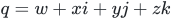</picture>

Where <picture><source media="(prefers-color-scheme: dark)" srcset="math/in-005-dark.svg"></picture> are scalar components and <picture><source media="(prefers-color-scheme: dark)" srcset="math/in-006-dark.svg"></picture> are imaginary basis elements satisfying quaternion multiplication rules.

A unit quaternion satisfies:

<picture><source media="(prefers-color-scheme: dark)" srcset="math/eq-003-dark.svg">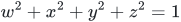</picture>

Unit quaternions are commonly used to represent spatial orientations because they provide a compact representation and support smooth rotational interpolation.

### 1.3 Quaternion Interpolation

Spherical Linear Interpolation, commonly called SLERP, interpolates between two normalized quaternions.

For normalized quaternions <picture><source media="(prefers-color-scheme: dark)" srcset="math/in-007-dark.svg"></picture> and <picture><source media="(prefers-color-scheme: dark)" srcset="math/in-008-dark.svg"></picture>:

<picture><source media="(prefers-color-scheme: dark)" srcset="math/eq-004-dark.svg">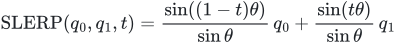</picture>

Where:

<picture><source media="(prefers-color-scheme: dark)" srcset="math/eq-005-dark.svg"></picture>

and:

<picture><source media="(prefers-color-scheme: dark)" srcset="math/eq-006-dark.svg"></picture>

SLERP provides interpolation along the spherical geometry of quaternion orientation space.

In practical applications, implementations commonly account for quaternion sign ambiguity and near-identical orientations (when <picture><source media="(prefers-color-scheme: dark)" srcset="math/in-009-dark.svg"></picture>, a linear-interpolation fallback is typically used).

### 1.4 The Special Euclidean Group SE(3)

While SO(3) represents rotation, SE(3) represents rigid transformations combining rotation and translation.

A homogeneous transformation matrix can be written as:

<picture><source media="(prefers-color-scheme: dark)" srcset="math/eq-007-dark.svg">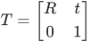</picture>

Where:

- <picture><source media="(prefers-color-scheme: dark)" srcset="math/in-010-dark.svg"></picture> represents orientation.
- <picture><source media="(prefers-color-scheme: dark)" srcset="math/in-011-dark.svg"></picture> represents translation.

A point in homogeneous coordinates can be transformed through:

<picture><source media="(prefers-color-scheme: dark)" srcset="math/eq-008-dark.svg"></picture>

This representation is widely used in robotics and spatial kinematics.

### 1.5 Lie Algebra and Exponential Maps

SO(3) and SE(3) are Lie groups.

Their corresponding Lie algebras provide local mathematical representations of transformations.

For a rotation vector <picture><source media="(prefers-color-scheme: dark)" srcset="math/in-012-dark.svg"></picture>, the exponential map relates a skew-symmetric matrix to a rotation:

<picture><source media="(prefers-color-scheme: dark)" srcset="math/eq-009-dark.svg"></picture>

The skew-symmetric matrix is:

<picture><source media="(prefers-color-scheme: dark)" srcset="math/eq-010-dark.svg">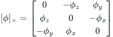</picture>

The logarithmic map performs the inverse operation within its valid domain.

These mappings are useful for representing small rotational changes, interpolation, and optimization involving orientations.

### Potential Applications

- Camera orientation.
- Robotics-inspired movement.
- Spatial animation.
- Pose interpolation.
- Three-dimensional transformations.
- Kinematic simulation.

---

## 2. Numerical Linear Algebra

**Related Module:** `SpectralLinearAlgebra`

Linear algebra provides the mathematical foundation for many numerical algorithms.

VectorForge explores matrix operations, matrix factorizations, eigenvalue calculations, and numerical methods for solving systems of equations.

### 2.1 Linear Systems

A linear system can be represented as:

<picture><source media="(prefers-color-scheme: dark)" srcset="math/eq-011-dark.svg"></picture>

Where:

- <picture><source media="(prefers-color-scheme: dark)" srcset="math/in-013-dark.svg"></picture> is the coefficient matrix.
- <picture><source media="(prefers-color-scheme: dark)" srcset="math/in-014-dark.svg"></picture> is the unknown solution vector.
- <picture><source media="(prefers-color-scheme: dark)" srcset="math/in-015-dark.svg"></picture> is the known right-hand-side vector.

The objective is to determine a vector <picture><source media="(prefers-color-scheme: dark)" srcset="math/in-014-dark.svg"></picture> satisfying the system.

The existence and uniqueness of a solution depend on the properties and rank of <picture><source media="(prefers-color-scheme: dark)" srcset="math/in-013-dark.svg"></picture>.

### 2.2 LU Decomposition

LU decomposition expresses a suitable square matrix as a product of lower and upper triangular matrices.

With pivoting, the relationship is commonly expressed as:

<picture><source media="(prefers-color-scheme: dark)" srcset="math/eq-012-dark.svg"></picture>

Where:

- <picture><source media="(prefers-color-scheme: dark)" srcset="math/in-016-dark.svg"></picture> is a permutation matrix.
- <picture><source media="(prefers-color-scheme: dark)" srcset="math/in-017-dark.svg">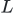</picture> is a lower triangular matrix.
- <picture><source media="(prefers-color-scheme: dark)" srcset="math/in-018-dark.svg"></picture> is an upper triangular matrix.

This decomposition allows linear systems to be solved through forward and backward substitution.

It is especially useful when solving multiple systems involving the same coefficient matrix.

### 2.3 Cholesky Decomposition

For a real symmetric positive-definite matrix, Cholesky decomposition expresses:

<picture><source media="(prefers-color-scheme: dark)" srcset="math/eq-013-dark.svg"></picture>

Where <picture><source media="(prefers-color-scheme: dark)" srcset="math/in-017-dark.svg"></picture> is a lower triangular matrix.

The method is computationally efficient for matrices satisfying the required mathematical conditions.

It is commonly used in numerical optimization, covariance processing, and statistical computation.

### 2.4 QR Decomposition

QR decomposition represents a matrix as:

<picture><source media="(prefers-color-scheme: dark)" srcset="math/eq-014-dark.svg"></picture>

Where:

- <picture><source media="(prefers-color-scheme: dark)" srcset="math/in-019-dark.svg"></picture> has orthonormal columns.
- <picture><source media="(prefers-color-scheme: dark)" srcset="math/in-001-dark.svg"></picture> is upper triangular.

Householder transformations provide a numerically useful method for constructing this factorization.

QR decomposition is particularly important in least-squares estimation because it can avoid some of the numerical difficulties associated with solving normal equations directly.

### 2.5 Least-Squares Estimation

Many practical problems involve more observations than unknown parameters.

In such situations, an exact solution may not exist.

Least-squares estimation seeks a solution minimizing the squared residual:

<picture><source media="(prefers-color-scheme: dark)" srcset="math/eq-015-dark.svg">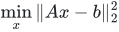</picture>

The residual is:

<picture><source media="(prefers-color-scheme: dark)" srcset="math/eq-016-dark.svg"></picture>

The objective is to minimize:

<picture><source media="(prefers-color-scheme: dark)" srcset="math/eq-017-dark.svg"></picture>

This method is widely used in regression, parameter estimation, and numerical modeling.

### 2.6 Eigenvalues and Eigenvectors

For a square matrix <picture><source media="(prefers-color-scheme: dark)" srcset="math/in-013-dark.svg"></picture>, an eigenvector <picture><source media="(prefers-color-scheme: dark)" srcset="math/in-020-dark.svg"></picture> and eigenvalue <picture><source media="(prefers-color-scheme: dark)" srcset="math/in-021-dark.svg">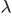</picture> satisfy:

<picture><source media="(prefers-color-scheme: dark)" srcset="math/eq-018-dark.svg"></picture>

Eigenvalues describe scaling factors along corresponding eigenvector directions.

Eigenvalue analysis is useful in understanding matrix structure, stability, and certain optimization problems.

For symmetric matrices, eigenvalues are real and eigenvectors can be chosen orthonormally.

### 2.7 Conjugate Gradient

Conjugate Gradient is an iterative method for solving systems of the form:

<picture><source media="(prefers-color-scheme: dark)" srcset="math/eq-011-dark.svg"></picture>

It is particularly suited to symmetric positive-definite matrices.

The method constructs a sequence of approximations using conjugate search directions.

Unlike direct matrix factorization, its computational requirements can be attractive for sufficiently large systems with suitable structure.

Its convergence depends on the conditioning of the matrix and the stopping criteria.

### Potential Applications

- Polynomial regression.
- Numerical optimization.
- Parameter estimation.
- Computational simulation.
- Matrix-based modeling.
- Scientific computation.

---

## 3. Bayesian State Estimation

**Related Module:** `BayesianStateEstimation`

State estimation concerns determining the internal state of a dynamic system using mathematical models and available observations.

In real applications, measurements often contain noise and uncertainty.

Bayesian estimation provides a framework for combining prior information with new observations.

### 3.1 Dynamic State Models

A general discrete-time state-space model can be written as:

<picture><source media="(prefers-color-scheme: dark)" srcset="math/eq-019-dark.svg"></picture>

<picture><source media="(prefers-color-scheme: dark)" srcset="math/eq-020-dark.svg"></picture>

Where:

- <picture><source media="(prefers-color-scheme: dark)" srcset="math/in-022-dark.svg"></picture> represents the system state.
- <picture><source media="(prefers-color-scheme: dark)" srcset="math/in-023-dark.svg"></picture> represents an optional control input.
- <picture><source media="(prefers-color-scheme: dark)" srcset="math/in-024-dark.svg"></picture> represents an observation.
- <picture><source media="(prefers-color-scheme: dark)" srcset="math/in-025-dark.svg"></picture> represents the state-transition function.
- <picture><source media="(prefers-color-scheme: dark)" srcset="math/in-026-dark.svg"></picture> represents the measurement function.
- <picture><source media="(prefers-color-scheme: dark)" srcset="math/in-027-dark.svg"></picture> represents process noise.
- <picture><source media="(prefers-color-scheme: dark)" srcset="math/in-028-dark.svg"></picture> represents measurement noise.

The objective is to estimate the hidden state from the available observations.

### 3.2 State Estimation

An estimator maintains an estimate of the system state and its associated uncertainty.

For a position-tracking system, the state might contain:

<picture><source media="(prefers-color-scheme: dark)" srcset="math/eq-021-dark.svg">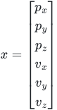</picture>

Where position and velocity are represented along three spatial axes.

This representation allows the estimator to account for both the current position and its movement.

### 3.3 Extended Kalman Filter

The Extended Kalman Filter extends Kalman filtering to nonlinear state-transition and measurement models.

It uses local linear approximations to propagate the state and covariance.

The prediction step estimates the next state:

<picture><source media="(prefers-color-scheme: dark)" srcset="math/eq-022-dark.svg"></picture>

The predicted covariance is:

<picture><source media="(prefers-color-scheme: dark)" srcset="math/eq-023-dark.svg"></picture>

Where:

- <picture><source media="(prefers-color-scheme: dark)" srcset="math/in-029-dark.svg"></picture> is the state-transition Jacobian.
- <picture><source media="(prefers-color-scheme: dark)" srcset="math/in-016-dark.svg"></picture> is the covariance matrix.
- <picture><source media="(prefers-color-scheme: dark)" srcset="math/in-030-dark.svg"></picture> is the process-noise covariance.

### 3.4 Measurement Correction

The predicted measurement is:

<picture><source media="(prefers-color-scheme: dark)" srcset="math/eq-024-dark.svg">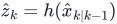</picture>

The innovation is:

<picture><source media="(prefers-color-scheme: dark)" srcset="math/eq-025-dark.svg"></picture>

It represents the difference between the actual observation and the predicted observation.

The innovation covariance is:

<picture><source media="(prefers-color-scheme: dark)" srcset="math/eq-026-dark.svg"></picture>

Where:

- <picture><source media="(prefers-color-scheme: dark)" srcset="math/in-031-dark.svg"></picture> is the measurement Jacobian.
- <picture><source media="(prefers-color-scheme: dark)" srcset="math/in-032-dark.svg"></picture> is the measurement-noise covariance.

The Kalman gain is:

<picture><source media="(prefers-color-scheme: dark)" srcset="math/eq-027-dark.svg">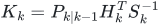</picture>

The corrected state estimate is:

<picture><source media="(prefers-color-scheme: dark)" srcset="math/eq-028-dark.svg"></picture>

A covariance update then incorporates the new measurement.

### 3.5 Innovation Gating

Not every observation should necessarily be accepted.

An observation that differs significantly from the predicted measurement may be an outlier.

A common statistical measure is the squared Mahalanobis distance:

<picture><source media="(prefers-color-scheme: dark)" srcset="math/eq-029-dark.svg">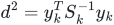</picture>

This measures the innovation relative to its predicted covariance.

An observation may be rejected when the statistic exceeds a selected threshold.

Threshold selection depends on the measurement dimension and the intended statistical rejection policy.

### Potential Applications

- Noisy position tracking.
- Motion estimation.
- Object trajectory prediction.
- Simulated sensor systems.
- Dynamic system modeling.
- Autonomous movement experiments.

---

## 4. Differential Path Geometry

**Related Module:** `DifferentialPathGeometry`

Differential geometry studies the geometric properties of curves and surfaces using differential calculus.

In VectorForge, the focus is on parameterized curves and their associated geometric properties in three-dimensional space.

### 4.1 Parameterized Curves

A three-dimensional curve can be represented as:

<picture><source media="(prefers-color-scheme: dark)" srcset="math/eq-030-dark.svg">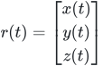</picture>

Where <picture><source media="(prefers-color-scheme: dark)" srcset="math/in-033-dark.svg"></picture> is a curve parameter.

The first derivative is:

<picture><source media="(prefers-color-scheme: dark)" srcset="math/eq-031-dark.svg">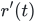</picture>

It describes the direction and rate of change of the curve with respect to its parameter.

The second derivative:

<picture><source media="(prefers-color-scheme: dark)" srcset="math/eq-032-dark.svg"></picture>

Describes how the first derivative changes.

These derivatives are fundamental to understanding the geometry of the curve.

### 4.2 Curve Interpolation

Hermite interpolation constructs smooth curves using endpoint positions and tangent information.

For a normalized parameter <picture><source media="(prefers-color-scheme: dark)" srcset="math/in-034-dark.svg"></picture>, a cubic Hermite curve can be expressed as:

<picture><source media="(prefers-color-scheme: dark)" srcset="math/eq-033-dark.svg">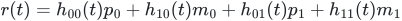</picture>

Where:

<picture><source media="(prefers-color-scheme: dark)" srcset="math/eq-034-dark.svg"></picture>

<picture><source media="(prefers-color-scheme: dark)" srcset="math/eq-035-dark.svg">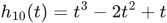</picture>

<picture><source media="(prefers-color-scheme: dark)" srcset="math/eq-036-dark.svg"></picture>

<picture><source media="(prefers-color-scheme: dark)" srcset="math/eq-037-dark.svg">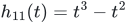</picture>

The vectors <picture><source media="(prefers-color-scheme: dark)" srcset="math/in-035-dark.svg"></picture> represent endpoint positions, while <picture><source media="(prefers-color-scheme: dark)" srcset="math/in-036-dark.svg"></picture> represent endpoint tangents.

This allows a curve to be constructed with control over both its positions and directional behaviour.

### 4.3 Curvature

Curvature describes how rapidly the direction of a curve changes relative to travelled distance.

For a regular three-dimensional curve:

<picture><source media="(prefers-color-scheme: dark)" srcset="math/eq-038-dark.svg">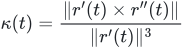</picture>

Where:

- <picture><source media="(prefers-color-scheme: dark)" srcset="math/in-037-dark.svg"></picture> is the first derivative.
- <picture><source media="(prefers-color-scheme: dark)" srcset="math/in-038-dark.svg"></picture> is the second derivative.
- <picture><source media="(prefers-color-scheme: dark)" srcset="math/in-039-dark.svg">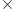</picture> represents the cross product.

A straight line has zero curvature.

A curve that changes direction more rapidly has greater curvature.

### 4.4 Torsion

Torsion describes the rate at which a three-dimensional curve twists out of its osculating plane.

For a sufficiently smooth regular curve:

<picture><source media="(prefers-color-scheme: dark)" srcset="math/eq-039-dark.svg">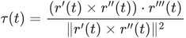</picture>

Where <picture><source media="(prefers-color-scheme: dark)" srcset="math/in-040-dark.svg"></picture> is the third derivative.

Curvature describes bending, while torsion describes spatial twisting.

### 4.5 Arc Length

The length of a curve between parameters <picture><source media="(prefers-color-scheme: dark)" srcset="math/in-041-dark.svg"></picture> and <picture><source media="(prefers-color-scheme: dark)" srcset="math/in-015-dark.svg"></picture> is:

<picture><source media="(prefers-color-scheme: dark)" srcset="math/eq-040-dark.svg">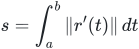</picture>

This represents the actual distance travelled along the curve rather than the straight-line distance between its endpoints.

For many curves, the integral cannot be expressed conveniently in a closed form.

Numerical integration can therefore be used to approximate the travelled distance.

### 4.6 Arc-Length Parameterization

A parameterized curve does not necessarily move at constant speed when its parameter changes uniformly.

Arc-length parameterization provides a way to determine the curve parameter corresponding to a desired travelled distance.

Given:

<picture><source media="(prefers-color-scheme: dark)" srcset="math/eq-041-dark.svg">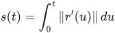</picture>

The goal is to find the parameter <picture><source media="(prefers-color-scheme: dark)" srcset="math/in-033-dark.svg"></picture> corresponding to a specified arc length <picture><source media="(prefers-color-scheme: dark)" srcset="math/in-042-dark.svg"></picture>.

This generally requires numerical inversion when no analytical inverse is available.

It is particularly useful for movement systems requiring approximately constant speed along curved trajectories.

### 4.7 Frenet Frames

A Frenet frame describes the local geometry of a regular curve using three mutually perpendicular vectors:

- Tangent <picture><source media="(prefers-color-scheme: dark)" srcset="math/in-043-dark.svg">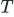</picture>.
- Normal <picture><source media="(prefers-color-scheme: dark)" srcset="math/in-044-dark.svg"></picture>.
- Binormal <picture><source media="(prefers-color-scheme: dark)" srcset="math/in-045-dark.svg"></picture>.

The tangent is:

<picture><source media="(prefers-color-scheme: dark)" srcset="math/eq-042-dark.svg">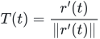</picture>

The normal is obtained from the normalized derivative of the tangent where defined.

The binormal is:

<picture><source media="(prefers-color-scheme: dark)" srcset="math/eq-043-dark.svg"></picture>

These vectors provide a local coordinate frame along a curve.

However, Frenet frames may become unstable when curvature approaches zero.

### 4.8 Parallel Transport Frames

Parallel transport provides an alternative method for constructing smoothly varying frames along a curve.

Unlike the traditional Frenet construction, it does not rely on the same curvature-dependent normal definition at every point.

This can help avoid sudden frame changes in regions where the curvature becomes very small.

Such frames are useful for orienting objects along complex three-dimensional paths.

### 4.9 Minimum-Jerk Trajectories

Minimum-jerk trajectories are designed to produce smooth motion with controlled velocity and acceleration.

A common normalized fifth-order interpolation function is:

<picture><source media="(prefers-color-scheme: dark)" srcset="math/eq-044-dark.svg"></picture>

For:

<picture><source media="(prefers-color-scheme: dark)" srcset="math/eq-006-dark.svg"></picture>

A position trajectory between two endpoints can be expressed as:

<picture><source media="(prefers-color-scheme: dark)" srcset="math/eq-045-dark.svg"></picture>

This formulation has zero velocity and acceleration at both endpoints when used with the normalized time parameter.

It is useful in smooth trajectory generation and movement interpolation.

### Potential Applications

- Procedural path generation.
- Smooth NPC trajectories.
- Camera rail systems.
- Vehicle movement.
- Three-dimensional animation.
- Geometric simulation.

---

## 5. Automatic Differentiation

**Related Module:** `AutomaticDifferentiation`

Automatic differentiation computes derivatives by applying the chain rule systematically to the elementary operations that form a computational expression. It differs from finite differences, which estimate derivatives through nearby function evaluations, and from symbolic differentiation, which manipulates algebraic expressions.

### 5.1 Forward-Mode Differentiation

A scalar intermediate value can be paired with its derivative with respect to an input:

<picture><source media="(prefers-color-scheme: dark)" srcset="math/eq-046-dark.svg">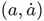</picture>

For an operation <picture><source media="(prefers-color-scheme: dark)" srcset="math/in-046-dark.svg">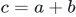</picture>:

<picture><source media="(prefers-color-scheme: dark)" srcset="math/eq-047-dark.svg">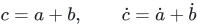</picture>

For a product <picture><source media="(prefers-color-scheme: dark)" srcset="math/in-047-dark.svg"></picture>:

<picture><source media="(prefers-color-scheme: dark)" srcset="math/eq-048-dark.svg"></picture>

For a composition <picture><source media="(prefers-color-scheme: dark)" srcset="math/in-048-dark.svg">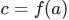</picture>:

<picture><source media="(prefers-color-scheme: dark)" srcset="math/eq-049-dark.svg">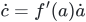</picture>

These rules allow derivative information to propagate through a sequence of supported operations.

### 5.2 Practical Considerations

Automatic differentiation is exact up to floating-point rounding for the operations and derivative rules implemented. It does not automatically guarantee that every Luau function or data type is differentiable or supported. The module's actual operation coverage and input conventions must be checked against its implementation.

**Potential applications:** sensitivity analysis, gradient-based optimization, parameter fitting, and numerical experimentation.

---

## 6. Rigid-Body Dynamics

**Related Module:** `RigidBodyDynamics`

Rigid-body dynamics studies how forces and torques influence the translational and rotational motion of a body.

### 6.1 Translational Dynamics

Newton's second law relates net force to linear acceleration:

<picture><source media="(prefers-color-scheme: dark)" srcset="math/eq-050-dark.svg"></picture>

Where <picture><source media="(prefers-color-scheme: dark)" srcset="math/in-049-dark.svg"></picture> is mass and <picture><source media="(prefers-color-scheme: dark)" srcset="math/in-050-dark.svg"></picture> is linear acceleration.

### 6.2 Rotational Dynamics

Angular motion is influenced by torque and the body's inertia. In a general body-fixed formulation, rotational dynamics involve angular velocity, angular momentum, and the inertia tensor. A simplified relationship for rotation about a fixed principal axis is:

<picture><source media="(prefers-color-scheme: dark)" srcset="math/eq-051-dark.svg"></picture>

Where <picture><source media="(prefers-color-scheme: dark)" srcset="math/in-051-dark.svg"></picture> is torque, <picture><source media="(prefers-color-scheme: dark)" srcset="math/in-003-dark.svg"></picture> is the relevant moment of inertia, and <picture><source media="(prefers-color-scheme: dark)" srcset="math/in-052-dark.svg"></picture> is angular acceleration.

### 6.3 Rigid-Body State

A rigid-body model may track position, orientation, linear velocity, and angular velocity. The exact state representation and numerical integration approach are implementation-specific.

**Potential applications:** mechanical simulation, robotics experiments, and motion modeling.

---

## 7. Numerical Optimization

**Related Module:** `NumericalOptimization`

Numerical optimization seeks parameters that minimize or maximize an objective function.

### 7.1 Objective Functions

A minimization problem can be written as:

<picture><source media="(prefers-color-scheme: dark)" srcset="math/eq-052-dark.svg">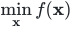</picture>

Where <picture><source media="(prefers-color-scheme: dark)" srcset="math/in-025-dark.svg"></picture> is an objective function and <picture><source media="(prefers-color-scheme: dark)" srcset="math/in-053-dark.svg"></picture> is a parameter vector.

### 7.2 Gradient-Based Updates

A basic gradient-descent update is:

<picture><source media="(prefers-color-scheme: dark)" srcset="math/eq-053-dark.svg"></picture>

Where <picture><source media="(prefers-color-scheme: dark)" srcset="math/in-054-dark.svg"></picture> is a step size and <picture><source media="(prefers-color-scheme: dark)" srcset="math/in-055-dark.svg"></picture> is the gradient.

The choice of step size, stopping criteria, conditioning, and objective landscape affects convergence. This equation illustrates a general optimization method; it does not assert that a particular optimizer is implemented by VectorForge.

### 7.3 Convergence and Validation

Optimization results should be assessed using objective values, gradient norms where available, iteration limits, and problem-specific constraints. A numerical result is not necessarily a global optimum.

**Potential applications:** parameter estimation, calibration, curve fitting, and numerical modeling.

---

## 8. Trajectory Planning

**Related Module:** `TrajectoryPlanning`

Trajectory planning constructs a time- or parameter-dependent description of motion between states or spatial targets.

### 8.1 Time-Parameterized Motion

A trajectory can be represented abstractly as:

<picture><source media="(prefers-color-scheme: dark)" srcset="math/eq-054-dark.svg"></picture>

Its derivatives describe velocity and acceleration:

<picture><source media="(prefers-color-scheme: dark)" srcset="math/eq-055-dark.svg"></picture>

For spatial motion, the representation may include position and orientation, depending on the planning model.

### 8.2 Boundary Conditions

A planning problem may specify initial and final positions, and may additionally constrain endpoint velocities or accelerations. These conditions influence the selected trajectory family and its smoothness.

### 8.3 Relationship to Path Geometry

A geometric path describes where motion travels, while a time parameterization describes how that path is traversed over time. The two concepts can be combined, but they are not interchangeable.

**Potential applications:** NPC movement, robotic motion experiments, camera motion, and procedural animation.

---

## 9. Numerical Analysis and Stability

Numerical analysis studies how mathematical problems can be approximated and solved using computational methods.

This discipline is particularly important when implementing mathematical algorithms in a programming environment that uses finite-precision floating-point arithmetic.

### 9.1 Floating-Point Precision

Computer arithmetic cannot represent every real number exactly.

As a result, calculations may accumulate small numerical errors.

For example, two mathematically equivalent expressions may produce slightly different numerical results due to floating-point rounding.

### 9.2 Numerical Tolerances

Instead of requiring exact equality, numerical algorithms commonly use a tolerance:

<picture><source media="(prefers-color-scheme: dark)" srcset="math/eq-056-dark.svg"></picture>

Where <picture><source media="(prefers-color-scheme: dark)" srcset="math/in-056-dark.svg">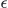</picture> is a selected numerical threshold.

The tolerance should depend on the scale and sensitivity of the calculation.

### 9.3 Singular and Ill-Conditioned Systems

A singular matrix does not have an ordinary inverse.

An ill-conditioned matrix may produce a solution that is highly sensitive to small changes in its input.

Such systems require careful numerical handling.

### 9.4 Iterative Convergence

Iterative algorithms progressively improve an approximation.

A common stopping condition uses the residual:

<picture><source media="(prefers-color-scheme: dark)" srcset="math/eq-057-dark.svg"></picture>

However, convergence criteria should be selected according to the algorithm and problem scale.

A low residual alone does not necessarily guarantee an accurate solution when the system is poorly conditioned.

### 9.5 Numerical Integration

Numerical integration approximates definite integrals when analytical solutions are unavailable or inconvenient.

This is particularly relevant to curve arc-length calculations and other continuous mathematical operations.

The approximation quality depends on the integration method, sampling strategy, and behaviour of the function being integrated.

---

## 10. Relationship Between Mathematical Domains

The eight mathematical modules address different problems, but their mathematical responsibilities can complement one another.

| Mathematical Domain | Related Module | Potential Relationship |
|---|---|---|
| Lie Groups | `LieGroupKinematics` | Spatial transformations and orientation |
| Linear Algebra | `SpectralLinearAlgebra` | Numerical foundations for matrix-based computation |
| Bayesian Estimation | `BayesianStateEstimation` | Prediction and uncertainty modeling |
| Differential Geometry | `DifferentialPathGeometry` | Trajectory and curve analysis |
| Automatic Differentiation | `AutomaticDifferentiation` | Derivatives for optimization and Jacobians |
| Rigid-Body Dynamics | `RigidBodyDynamics` | Force, torque, and motion modeling |
| Numerical Optimization | `NumericalOptimization` | Parameter fitting and calibration |
| Trajectory Planning | `TrajectoryPlanning` | Time-parameterized motion between states |

For example, a hypothetical autonomous movement system could combine these concepts:

1. State estimation determines an object's estimated position and velocity.
2. Differential geometry constructs a smooth trajectory.
3. Spatial transformation mathematics determines the object's orientation along the trajectory.
4. Numerical linear algebra supports matrix calculations required by the estimation process.

This is an illustrative system design, not a built-in integrated feature of VectorForge.

---

## 11. Applications in Roblox

The mathematical concepts explored by VectorForge can be applied to several areas of Roblox development.

### Spatial Systems

Quaternion mathematics and rigid transformations can support advanced orientation and pose calculations.

### Procedural Movement

Differential geometry can support path generation and movement along complex trajectories.

### Motion Estimation

Bayesian filtering can be used to explore how systems estimate movement from noisy observations.

### Mathematical Simulation

Numerical linear algebra and iterative solvers can provide foundations for experimental simulation systems.

### Procedural Animation

Interpolation, geometric frames, and trajectory functions can help produce smoother motion.

These applications are intended as possibilities for experimentation rather than claims of complete production-ready functionality.

---

## 12. Mathematical Limitations

Mathematical algorithms are subject to assumptions and numerical constraints.

The following limitations should be considered when working with VectorForge:

- Floating-point arithmetic introduces numerical approximation.
- Singular and ill-conditioned matrices may cause computational difficulties.
- Quaternion operations require appropriate normalization and convention handling.
- Curve derivatives may become degenerate.
- Frenet frames may become unstable near zero curvature.
- Numerical integration introduces approximation error.
- Iterative methods may fail to converge under unsuitable conditions.
- State-estimation quality depends on model and noise assumptions.

The mathematical correctness of an algorithm should be evaluated independently of whether its implementation executes without errors.

## Further Reading

The mathematical disciplines represented in VectorForge are extensively studied in numerical analysis, robotics, computational geometry, and applied mathematics.

The following subjects provide useful foundations for understanding and extending the project:

- Linear Algebra.
- Numerical Analysis.
- Differential Geometry.
- Lie Groups and Lie Algebras.
- Probability Theory.
- Bayesian Filtering.
- Optimization.
- Computational Kinematics.

---

*VectorForge explores the practical implementation of advanced mathematical techniques within Roblox Luau. This document provides theoretical context for the project's mathematical direction; implementation-specific behaviour must always be verified against the source code.*
