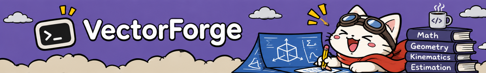

 <div align="center">

# VectorForge




### Roblox Luau를 위한 고급 계산 수학

**[English](../../README.md)** · [简体中文](README_zh.md) · [日本語](README_ja.md) · 한국어 · [Tiếng Việt](README_vi.md) · [ไทย](README_th.md) · [العربية](README_ar.md) · [MA Darija](README_darija.md)

**Roblox 안에서 수치 기법, 기하 계산 및 수학 시스템을 직접 탐구하세요.**

VectorForge는 Lie 군 운동학, 수치 선형대수, 베이지안 상태 추정, 미분기하학 등을 포함한 고급 계산 수학의 구현을 탐구하는 실험적인 Luau 라이브러리입니다.

<p align="center">
  <a href="https://luau.org/"></a>
  <a href="https://www.roblox.com/"></a>
  <a href="LICENSE"></a>
  <a href="#project-status"></a>
  <br>
  
  
  
  
</p>

**[빠른 시작](#quick-start) · [핵심 모듈](#core-modules) · [과학 확장](#scientific-extensions) · [예제](#examples) · [실험](#experiments) · [시뮬레이션](#simulations) · [데이터셋](#datasets) · [시각화](#visualizations) · [문서](#documentation)**

</div>

---

## 개요

Roblox는 인터랙티브 경험을 제작하기에 편리한 환경을 제공하지만, 일부 수학 문제에는 더 전문적인 수치 기법이 필요합니다.

VectorForge는 독립적인 수학 모듈 모음을 통해 이러한 기법을 Luau로 구현하는 방법을 탐구합니다. 저장소에는 유체 역학, 유한 요소법, 양자 역학, 전자기학, 연속체 역학, 궤도 역학, 확률 과정 등 과학 계산 주제를 다루는 더 큰 실험적 연구 계층도 포함되어 있습니다.

이 프로젝트는 수치해석, 로보틱스, 계산 기하학, 고전 역학, 확률론 및 최적화에서 흔히 다루는 개념을 포함합니다.

Roblox의 내장 API를 대체하려는 것이 아니라, VectorForge는 일반적인 게임 스크립팅의 범위를 넘어서는 수학 연산에 집중합니다.

**목표는 고급 수학 기법을 Roblox에서 쉽게 접근하고, 재사용하며, 실험할 수 있도록 만드는 것입니다.**

<a id="quick-start"></a>
## 빠른 시작

### 설치

VectorForge는 수동으로 설치하거나 포함된 Rojo 프로젝트 구성을 사용할 수 있습니다.

**수동 설치**

1. Roblox Studio를 엽니다.
2. `ReplicatedStorage`로 이동합니다.
3. `VectorForge`라는 폴더를 만듭니다.
4. `src/VectorForge/`의 ModuleScript를 해당 폴더로 복사합니다.
5. `ReplicatedStorage/VectorForgeShared`를 만들고 공유 유틸리티 ModuleScript를 그 안에 복사합니다.
6. 원래 ModuleScript 이름과 폴더 구조를 유지합니다.

Explorer 계층 구조는 다음과 같아야 합니다.

```text
ReplicatedStorage
└── VectorForge
    ├── LieGroupKinematics
    ├── SpectralLinearAlgebra
    ├── BayesianStateEstimation
    ├── DifferentialPathGeometry
    ├── AutomaticDifferentiation
    ├── RigidBodyDynamics
    ├── NumericalOptimization
    └── TrajectoryPlanning
```

### Rojo

VectorForge에는 Rojo 프로젝트 구성이 포함되어 있습니다.

`default.project.json`에서 `src/VectorForge`가 `ReplicatedStorage/VectorForge`로, 저장소 루트의 `VectorForgeShared/`가 `ReplicatedStorage/VectorForgeShared`로 매핑되는지 확인하세요. 해당 매핑에 의존하기 전에 프로젝트 파일을 확인하세요.

프로젝트 빌드:

```bash
rojo build default.project.json -o VectorForge.rbxlx
```

[Rojo 문서](https://rojo.space/)

### 기본 사용법

설치 후 Roblox의 `require()` 함수를 사용해 모듈을 불러옵니다.

```lua
local ReplicatedStorage = game:GetService("ReplicatedStorage")

local VectorForge = ReplicatedStorage:WaitForChild("VectorForge")
local VectorForgeShared = ReplicatedStorage:WaitForChild("VectorForgeShared")

local SharedConstants = require(VectorForgeShared:WaitForChild("Constants"))
local Lie = require(VectorForge.LieGroupKinematics)
local LinearAlgebra = require(VectorForge.SpectralLinearAlgebra)
local StateEstimation = require(VectorForge.BayesianStateEstimation)
local PathGeometry = require(VectorForge.DifferentialPathGeometry)

local AutomaticDifferentiation =
    require(VectorForge.AutomaticDifferentiation)

local RigidBodyDynamics =
    require(VectorForge.RigidBodyDynamics)

local NumericalOptimization =
    require(VectorForge.NumericalOptimization)

local TrajectoryPlanning =
    require(VectorForge.TrajectoryPlanning)
```

각 모듈은 자체 기능을 제공합니다. 사용 가능한 연산, 매개변수 및 반환값은 [API 참조](../../docs/API.md)를 확인하세요.

---

<a id="core-modules"></a>
## 핵심 모듈

VectorForge는 현재 8개의 수학 분야를 탐구합니다.

| 모듈 | 수학 분야 | 주요 초점 |
|---|---|---|
| `LieGroupKinematics` | Lie 이론 | 회전 및 강체 변환 |
| `SpectralLinearAlgebra` | 선형대수 | 행렬 연산 및 수치 솔버 |
| `BayesianStateEstimation` | 확률론 | 상태 추정 및 불확실성 |
| `DifferentialPathGeometry` | 미분기하학 | 곡선, 곡률 및 경로 분석 |
| `AutomaticDifferentiation` | 수치 미적분 | 도함수 전파 |
| `RigidBodyDynamics` | 고전 역학 | 힘, 토크 및 강체 운동 |
| `NumericalOptimization` | 최적화 | 수치 최소화 |
| `TrajectoryPlanning` | 모션 계획 | 궤적 구성 및 평가 |

### 1. LieGroupKinematics

**Lie 군 · 회전 이론 · 강체 운동학**

3차원 공간의 회전과 강체 변환을 표현하기 위한 수학적 방법입니다.

다루는 개념:

- 쿼터니언 대수.
- SO(3) 회전 연산.
- SE(3) 강체 변환.
- 지수 사상과 로그 사상.
- 구면 선형 보간(SLERP).
- 포즈 합성과 역변환.
- 트위스트 표현.

**가능한 응용 분야**

- 절차적 애니메이션.
- 부드러운 카메라 방향 제어.
- 로보틱스에서 영감을 받은 이동.
- 3차원 포즈 보간.
- 공간 시뮬레이션.

### 2. SpectralLinearAlgebra

**수치 선형대수 · 행렬 계산**

행렬 조작, 선형 시스템 풀이 및 수학적 분해를 위한 수치 기법입니다.

다루는 개념:

- 행렬 곱셈 및 전치.
- LU 분해.
- 행렬식 계산.
- Cholesky 분해.
- Householder QR 분해.
- 대칭 행렬 고유값 근사.
- 켤레기울기법.
- 최소제곱 추정.
- 선형 시스템 풀이.

**가능한 응용 분야**

- 수치 시뮬레이션.
- 다항 회귀.
- 매개변수 추정.
- 수학적 최적화.
- 계산 모델링.

### 3. BayesianStateEstimation

**베이지안 추론 · 확률론 · 상태 추정**

관측이 불완전하거나 불확실성의 영향을 받을 때 동적 시스템의 내부 상태를 추정하는 방법입니다.

다루는 개념:

- 확장 칼만 필터(EKF).
- 상태 전이 모델.
- 측정 모델.
- 공분산 전파.
- 수치 야코비안 근사.
- 측정 보정.
- 혁신(innovation) 계산.
- 통계적 측정 게이팅.

**가능한 응용 분야**

- 노이즈가 있는 물체 위치 추적.
- 운동 예측.
- 센서 시뮬레이션.
- 궤적 추정.
- 동적 시스템 모델링.

### 4. DifferentialPathGeometry

**미분기하학 · 곡선 분석**

매개변수화된 곡선과 그 기하학적 특성을 수학적으로 분석합니다.

다루는 개념:

- Hermite 곡선 보간.
- 1차 및 고차 도함수.
- 곡률과 비틀림.
- 수치 호 길이 적분.
- 호 길이 매개변수화.
- Frenet 프레임.
- 평행 이동 프레임.
- 최근접점 추정.
- 최소 jerk 궤적 생성.

**가능한 응용 분야**

- 절차적 경로 생성.
- 부드러운 NPC 궤적.
- 카메라 레일 시스템.
- 차량 궤적 모델링.
- 3차원 운동 분석.

### 5. AutomaticDifferentiation

**자동 미분 · 수치 미적분**

산술 연산과 지원되는 계산식 전반에 도함수 정보를 전파하여 도함수 계산을 탐구합니다.

다루는 개념:

- 전진 모드 도함수 전파.
- 계산식 평가.
- 도함수 추적.
- 민감도 분석.

**가능한 응용 분야**

- 기울기 기반 최적화.
- 매개변수 피팅.
- 민감도 분석.
- 미분 가능한 수학 실험.

### 6. RigidBodyDynamics

**고전 역학 · 물리 시뮬레이션**

가해진 힘, 토크 및 관성 특성에 따른 강체 운동의 수학적 표현을 탐구합니다.

다루는 개념:

- 선형 운동과 각운동.
- 질량 및 관성 표현.
- 힘과 토크의 관계.
- 강체 상태의 시간 변화.
- 병진 및 회전 동역학.

**가능한 응용 분야**

- 물리 실험.
- 기계 시스템 모델링.
- 로보틱스에서 영감을 받은 시뮬레이션.
- 운동 분석.

### 7. NumericalOptimization

**수치 최적화 · 반복 최소화**

지원되는 가정과 제약 조건 아래에서 목적 함수를 최소화하는 해를 찾는 수치 기법을 탐구합니다.

다루는 개념:

- 목적 함수 평가.
- 반복적인 매개변수 갱신.
- 기울기 기반 최적화 개념.
- 수렴 기준.
- 수치 최소화.

**가능한 응용 분야**

- 매개변수 추정.
- 곡선 피팅.
- 수학적 보정.
- 최적화 실험.

### 8. TrajectoryPlanning

**모션 계획 · 궤적 생성**

상태 사이 또는 공간 목표 사이의 경로와 시간 의존적 운동 프로파일을 구성하고 평가하는 데 중점을 둡니다.

다루는 개념:

- 궤적 구성.
- 운동 프로파일 평가.
- 경계 조건 처리.
- 부드러운 이동 계획.
- 기하학 및 운동학 표현과의 통합.

**가능한 응용 분야**

- NPC 이동.
- 로보틱스에서 영감을 받은 경로 계획.
- 카메라 및 물체 이동.
- 절차적 애니메이션.

---

<a id="scientific-extensions"></a>
## 과학 확장

저장소에는 기존 8개 핵심 모듈과 별도로 실험적인 확장 계층이 포함되어 있습니다. 추가 항목은 저장소 루트에서 과학 분야별로 구성되며 `src/VectorForge/` 안에는 배치되지 않습니다. 따라서 기존 핵심 라이브러리와 더 넓은 연구 모듈이 분리되어 있습니다.

현재 확장 패키지는 다음으로 구성됩니다.

- **15개의 과학 분야 폴더**
- **300개의 분야 모듈**(각 분야에 20개)
- **30개의 분야 지원 모듈**(각 분야 폴더 루트에 추가 파일 2개)
- `VectorForgeShared/`의 **공유 유틸리티 모듈 7개**
- **이름이 지정된 시뮬레이션 예제 10개**
- **수치 불변식 및 검증 예제 10개**

확장 패키지에는 이 README를 제외하고 **357개의 Lua 파일**이 있습니다. 이는 저장소 파일 수를 집계한 것이며, 모든 모듈이 완전히 검증된 과학 솔버라는 뜻은 아닙니다.

### 과학 분야

| 분야 폴더 | 주요 연구 영역 |
|---|---|
| `fluid-dynamics/` | 유동 모델, 운동량 방정식, 수송 및 유체 솔버 기초 |
| `control-systems/` | 상태 공간 모델, 피드백 제어, 관측기 및 안정성 분석 |
| `finite-element-methods/` | 요소 정식화, 재료 데이터, 구적법 및 조립 개념 |
| `signal-processing/` | 이산 변환, 필터링, 컨볼루션 및 샘플링 이론 |
| `tensor-calculus/` | 텐서 저장, 축약, 계량 및 미분 연산 |
| `differential-equations/` | 초기값 적분, 경계값 문제 및 수치 시간 전진 |
| `computational-geometry/` | 매개변수 곡선, 곡률, 기하 판정 및 메시 개념 |
| `optimization-methods/` | 기울기 방법, 선 탐색, 최소제곱 목적 함수 및 종료 규칙 |
| `quantum-mechanics/` | 파동함수 표현, 확률 밀도 및 양자 모델 기초 |
| `thermodynamics/` | 상태 방정식, 열적 특성, 에너지 및 열역학 변환 |
| `electromagnetics/` | 전자기장, 로렌츠 힘, 상수 및 장 샘플링 |
| `orbital-mechanics/` | 두 물체 운동, 궤도 매개변수 및 천체역학 상수 |
| `rigid-body-physics/` | 관성, 각운동량, 접촉 설정 및 회전 동역학 |
| `continuum-mechanics/` | 변형률 측도, 탄성 재료 데이터 및 구성 모델 기초 |
| `stochastic-processes/` | 확률 과정, 확률적 시간 전진 및 확률 분포 |

### 폴더 구성

각 과학 분야에는 세 개의 하위 폴더가 있습니다.

- `analysis/` — 분석 중심 모듈 및 계산
- `models/` — 모델 및 상태 표현
- `solvers/` — 수치 절차 및 솔버 관련 모듈

각 분야 폴더의 루트에는 지원 모듈 두 개도 추가로 있습니다. 이 모듈은 분야별 설정, 재료 데이터, 상수, 샘플링 규칙 또는 도우미 함수를 제공합니다.

공유 유틸리티는 루트의 단일 `VectorForgeShared/` 폴더에 있습니다. Roblox Studio에서는 이 폴더를 `ReplicatedStorage/VectorForgeShared` 아래에 배치합니다.

| 모듈 | 역할 |
|---|---|
| `Constants.lua` | 공유 물리 상수 및 수학 상수 |
| `CoreRegistry.lua` | 기존 VectorForge 핵심 모듈의 명시적 등록 및 조회 |
| `EquationCatalog.lua` | 참조용 지배 방정식 간단 목록 |
| `LinearAlgebra.lua` | 기본 행 배열 행렬 연산 |
| `NumericalGuards.lua` | 유한값 검사, 클램핑 및 안전한 나눗셈 |
| `NumericalKernels.lua` | 공유 저수준 수치 커널 |
| `SimulationClock.lua` | 고정 시간 간격 시뮬레이션 타이밍 |

### 핵심 모듈과의 통합

확장 모듈은 `src/VectorForge/`와 분리되어 있습니다. `VectorForgeShared/CoreRegistry.lua`는 부트스트랩 스크립트가 실제 핵심 모듈 인스턴스를 등록할 수 있도록 의존성 주입 메커니즘을 제공합니다.

레지스트리는 모듈 경로를 추측하거나 핵심 모듈을 자동으로 불러오지 않습니다. 프로젝트에 실제로 존재하며 공개 API를 확인한 모듈만 등록하세요.

**중요:** `VectorForgeShared`라는 이름의 공유 폴더 하나만 사용하세요. `shared`, `Shared`, `VectorForgeShared` 아래에 별도 복사본을 두지 마세요. 분야 모듈과 부트스트랩 스크립트는 동일한 `ReplicatedStorage/VectorForgeShared` 인스턴스를 참조해야 합니다.

예제:

```lua
local ReplicatedStorage = game:GetService("ReplicatedStorage")
local Shared = ReplicatedStorage:WaitForChild("VectorForgeShared")
local CoreRegistry = require(Shared:WaitForChild("CoreRegistry"))

CoreRegistry.Configure({
    SpectralLinearAlgebra = require(path.to.src.VectorForge.SpectralLinearAlgebra),
    AutomaticDifferentiation = require(path.to.src.VectorForge.AutomaticDifferentiation),
    BayesianStateEstimation = require(path.to.src.VectorForge.BayesianStateEstimation),
})

local LinearAlgebraCore = CoreRegistry.Require("SpectralLinearAlgebra")
```

확장 소스는 숫자 배열로 수학적 상태를 표현하며 Roblox 공간 데이터 형식에 직접 의존하지 않습니다. 그렇다고 모든 알고리즘이 완전한 물리 솔버이거나 모든 모듈이 참조 구현으로 검증되었다는 뜻은 아닙니다.

### 예제 및 검증 파일

`examples/` 폴더에는 감쇠 진동자 응답, 결합 상태 시간 변화, 비선형 응답, 에너지 감쇠, 적분 안정성 및 장시간 상태 시간 변화 등을 다루는 개별 수치 연구가 포함됩니다.

`tests/`의 확장 테스트에는 작은 규모의 수치 불변식 검사가 포함됩니다. 회귀 테스트의 출발점으로 유용하지만 해석적 벤치마크, 차원 검사, 수렴 연구 또는 신뢰할 수 있는 과학 데이터와의 검증을 대체하지는 않습니다.

### 연구 및 프로덕션 상태

과학 확장은 실험적 연구 기반입니다. 일부 모듈은 재사용 가능한 수치 루틴과 분야별 계산을 제공하지만, 다른 모듈은 문제별 이산화, 경계 조건, 구성 법칙, 단위 및 솔버 전략이 더 필요한 기반을 제공합니다.

프로덕션 경험에서 확장 모듈을 사용하기 전에:

1. 모듈의 입력, 출력, 차원 및 단위를 확인합니다.
2. 가정과 경계 조건을 검증합니다.
3. 결과를 해석해 또는 신뢰할 수 있는 참조 데이터와 비교합니다.
4. 대표적인 입력 범위에서 수렴성과 수치 안정성을 테스트합니다.
5. Roblox Studio에서 실행 비용을 프로파일링합니다.
6. 실제 공개 API를 기준으로 핵심 모듈 통합을 검증합니다.

이 추가 항목은 저장소의 연구 범위를 확장하지만 기존 8개 핵심 모듈의 설치 단계는 변경하지 않습니다.

---

## VectorForge의 작동 방식

VectorForge는 Roblox 경험에서 사용할 수 있는 독립적인 수학 모듈 모음을 제공합니다. 문제나 수학 모델을 정의하고 관련 모듈을 선택한 다음 필요한 입력을 제공하고 반환된 결과를 자신의 시스템에서 사용합니다.

아래 다이어그램은 이 작업 흐름의 개략적인 개요를 보여 줍니다. 이는 개발자가 라이브러리를 사용하는 방법에 대한 개념적 설명이며 모든 모듈이 자동으로 연결되거나 VectorForge가 하나의 고정 파이프라인을 실행한다는 의미는 아닙니다.


## VectorForge의 구성 방식

모듈은 서로 다른 수학적 책임을 중심으로 구성되어 있습니다.


모듈식 구조는 다음을 지원하도록 설계되었습니다.

- 독립적인 수학 구성 요소.
- 재사용 가능한 구현.
- 명확한 책임 분리.
- 더 쉬운 테스트 및 유지 관리.
- 향후 수학 확장.

자세한 내용은 [ARCHITECTURE.md](../../docs/ARCHITECTURE.md)를 참조하세요.

---

<a id="examples"></a>
## 예제

`examples/` 디렉터리에는 선택한 VectorForge 모듈을 Roblox에서 사용하는 방법을 보여 주는 독립 실행형 데모가 포함됩니다.

| 예제 | 설명 |
|---|---|
| 포즈 보간 | 강체 포즈 사이의 보간 |
| 미분 경로 | 기하학적 경로를 따라 곡선을 샘플링하고 이동 |
| 베이지안 모션 추적 | 노이즈가 있는 위치 관측을 이용한 추정 |
| 최소제곱 회귀 | 수치 선형대수를 이용한 다항식 피팅 |
| 적분 데모 | 확장 모듈 모음을 활용하는 데모 |

각 예제는 독립적으로 이해할 수 있도록 구성되며 추가 실험의 출발점이 됩니다.

[examples/README.md](../../examples/README.md)를 참조하세요.

<a id="experiments"></a>
## 실험

`experiments/` 디렉터리에는 수학 개념을 시각화하고 가능한 응용 분야를 살펴보는 탐색용 스크립트가 포함됩니다.

| 실험 | 설명 |
|---|---|
| 천체 역학 | 단순화한 중력 운동의 교육용 시각화 |
| 궤도 시뮬레이션 | 단순화한 역학을 이용한 궤도 궤적 탐구 |
| 칼만 시각화 | 노이즈 관측 및 평활화 추정의 시각화 |
| 궤적 연구실 | 실험적 궤적 구성 |
| 수치 안정성 연구실 | 수치 합산 방법 비교 |

이 실험은 프로덕션용 시뮬레이션이 아니라 탐색을 위한 것입니다.

일부 데모는 단순화된 참조 계산이나 시각화 어댑터를 사용합니다. 예를 들어 천체 및 궤도 데모는 일반 상대성 이론이 아닌 단순화된 뉴턴 역학 모델을 사용합니다. 칼만 시각화는 완전한 EKF 구현이 아니라 단순화된 평활화 데모입니다.

[experiments/README.md](../../experiments/README.md)를 참조하세요.


<a id="simulations"></a>
## 시뮬레이션

`simulations/` 폴더에는 독립 실행형 수치 모델 몇 가지가 저장됩니다. Roblox 장면에 계산을 연결하지 않고 시스템이 시간에 따라 어떻게 변하는지 테스트할 때 유용합니다.

현재 스크립트는 두 가지 문제를 다룹니다.

| 스크립트 | 모델링 대상 |
|---|---|
| `TwoBodyOrbit.lua` | 단순화된 뉴턴 중력 모델의 상대 운동 |
| `DampedOscillator.lua` | 선형 감쇠가 있는 스프링에 연결된 질량 |

두 스크립트 모두 4차 Runge–Kutta 단계를 사용합니다. 호출자가 초기 상태와 시간 간격을 제공하므로 시뮬레이션 시계와 중지 조건은 호출자가 제어합니다.

궤도 예제는 SI 단위인 미터, 초당 미터, 초 및 세제곱미터 매 제곱초 단위의 중력 매개변수를 사용합니다. 진동자는 미터, 킬로그램, 초, 미터당 뉴턴 및 미터당 뉴턴초를 사용합니다.

이는 의도적으로 작은 모델입니다. 궤도 스크립트는 추가 천체, 대기 저항, 충돌 또는 상대론적 효과를 고려하지 않습니다. 진동자는 선형 스프링과 선형 점성 감쇠를 가정합니다. 어느 쪽도 프로덕션 물리 엔진으로 취급해서는 안 됩니다.

각 스크립트의 설정, 매개변수 및 한계는 [simulations/README.md](../../simulations/README.md)를 참조하세요.

<a id="datasets"></a>
## 데이터셋

`datasets/` 폴더에는 프로젝트 스크립트와 실험에서 사용하는 참조값 및 샘플 데이터가 있습니다. 데이터를 알고리즘과 분리하면 동일한 입력을 재사용하고 데모가 정확히 어떤 데이터를 사용하는지 확인하기 쉽습니다.

| 파일 | 내용 |
|---|---|
| `PhysicalConstants.lua` | SI 단위로 표현된 소량의 물리 상수 |
| `SolarSystem.lua` | 선택한 행성의 근사 질량, 평균 장반경, 공전 주기 및 파생 중력 매개변수 |
| `MotionSamples.lua` | 타임스탬프가 있는 합성 2D 위치 관측의 짧은 시퀀스 |

행성 값은 반올림된 참조 데이터이며 정밀 천체력은 아닙니다. 운동 샘플은 생성된 예제이지 실제 센서 측정값이 아닙니다. 수치 비교나 상태 추정 실험에서는 이러한 차이가 중요합니다.

데이터를 추가할 경우 단위를 포함하고 측정값, 합성 데이터 또는 근삿값인지 명시하세요. 나중에 생길 혼란을 줄일 수 있습니다.

데이터 규약 및 사용 예제는 [datasets/README.md](../../datasets/README.md)를 참조하세요.

<a id="visualizations"></a>
## 시각화

`visualizations/` 폴더에는 계산 결과를 3D 장면에 표시하는 소규모 Roblox 도우미가 포함됩니다. 수학 계산과 그리기를 분리하는 것이 목적입니다. 시뮬레이션이나 알고리즘이 값을 생성하면 렌더러가 이를 확인할 수 있는 형태로 바꿉니다.

| 모듈 | 표시 내용 |
|---|---|
| `TrajectoryRenderer.lua` | 고정된 세그먼트로 연결된 `Vector3` 점의 시퀀스 |
| `VectorFieldRenderer.lua` | 방향 표시기로 나타낸 벡터 샘플 |

두 모듈 모두 사용자가 지정한 부모 아래에 `Model`을 생성합니다. 파트는 고정되어 있고 충돌하지 않습니다. 시각화가 끝나면 반환된 모델을 삭제해 생성된 인스턴스를 정리하세요.

이 도우미는 디버깅과 소규모 데모를 위한 것이며 밀집된 과학 플로팅을 위한 것이 아닙니다. 특히 파트를 자주 복제하거나 다시 만들면 파트 수가 많을수록 비용이 커질 수 있습니다. 샘플 수를 적절히 유지하고 Studio에서 프로파일링하세요.

예제와 렌더러 옵션은 [visualizations/README.md](../../visualizations/README.md)를 참조하세요.

## 벤치마킹

`benchmarks/` 디렉터리에는 선택된 수학 연산의 성능을 조사하는 워크로드 중심 스크립트가 포함됩니다.

현재 벤치마크 영역:

- 행렬 계산.
- 수치 최적화.
- 미분기하학.
- 상태 추정.
- 공유 벤치마크 유틸리티.

벤치마크 결과는 하드웨어, 런타임 환경, 입력 차원 및 구현 세부 사항에 따라 달라질 수 있습니다.

일부 스크립트는 워크로드 콜백을 검증된 공개 API에 연결하는 어댑터가 필요합니다. 스크립트가 있다는 사실만으로 포괄적인 성능 측정이 완료되었다는 뜻은 아닙니다.

문서:

- [벤치마킹 가이드](../../docs/BENCHMARKING.md)
- [벤치마크 스크립트](../../benchmarks/README.md)

## 수학적 기초

VectorForge는 여러 수학 분야를 바탕으로 합니다.

| 분야 | 개념 |
|---|---|
| 선형대수 | 행렬 연산, 분해, 고유값 |
| 미분기하학 | 곡률, 비틀림, 접선 및 법선 프레임 |
| Lie 이론 | SO(3), SE(3), 지수 사상 및 로그 사상 |
| 수치해석 | 근사, 적분, 반복 솔버 |
| 확률론 | 베이지안 추정 및 불확실성 |
| 최적화 | 최소제곱 추정 및 반복 최소화 |
| 신호 처리 | 주파수 영역 분석 및 수치 변환 |

추가 설명은 [MATHEMATICS.md](../../docs/MATHEMATICS.md)를 참조하세요.

## 연구 노트

`research/` 디렉터리에는 보조 수학 노트와 탐색 자료가 포함됩니다.

현재 주제:

- Lie 군 수학 및 공간 변환.
- 수치 기법 및 계산 안정성.
- 베이지안 상태 추정.
- 향후 알고리즘 및 수학 확장 후보.

이 노트는 개발 과정에서의 이론적 고려 사항과 가능한 접근법을 기록합니다. 보충 자료이며 공식적인 수학적 검증은 아닙니다.

[research/README.md](../../research/README.md)를 참조하세요.

---

## 테스트

VectorForge에는 각 모듈의 중요한 연산을 다루는 회귀 테스트 및 종합 테스트 스크립트가 포함됩니다.

현재 테스트 영역:

- 쿼터니언 연산 및 강체 변환.
- 행렬 곱셈 및 분해.
- 선형 시스템 풀이.
- 고유값 계산.
- 수치 최적화.
- 확장 칼만 필터 연산.
- 곡선 평가 및 미분 특성.
- 호 길이 계산.
- 궤적 경계 조건.
- 자동 미분.
- 강체 동역학 및 궤적 계획.

### 테스트 실행

1. VectorForge 모듈을 `ReplicatedStorage/VectorForge`에 설치합니다.
2. 테스트 실행기를 `ServerScriptService` 안에 배치합니다.
3. Roblox Studio에서 Play 세션을 시작합니다.
4. Output 창을 엽니다.
5. 테스트 결과를 확인합니다.

이 테스트 모음은 초기 회귀 테스트 기반을 제공하지만 공식적인 수학적 검증을 의미하거나 수치 안정성을 보장하지는 않습니다.

[tests/README.md](../../tests/README.md)를 참조하세요.

## 성능 고려 사항

수치 알고리즘의 비용은 입력 차원, 반복 횟수 및 실행 빈도에 따라 커질 수 있습니다.

VectorForge를 사용할 때 다음을 고려하세요.

- 불필요한 행렬 분해를 피합니다.
- 입력이 변경되지 않았다면 계산 결과를 재사용합니다.
- 프레임에 종속된 루프 안에서 비용이 큰 연산을 제한합니다.
- 적절한 솔버 허용 오차와 반복 횟수 제한을 선택합니다.
- 대표적인 워크로드로 프로파일링합니다.
- 적절한 경우 서버의 권위 있는 계산과 클라이언트 시각화 계산을 분리합니다.

현재 구현은 아직 포괄적인 벤치마크를 거치지 않았습니다.

## 저장소 구조

```text
VectorForge/
├── benchmarks/
├── computational-research/
├── datasets/
├── docs/
├── examples/
│   └── server/
├── experiments/
├── research/
├── simulations/
├── visualizations/
│
├── fluid-dynamics/
│   ├── analysis/
│   ├── models/
│   ├── solvers/
│   └── domain support modules
├── control-systems/
│   ├── analysis/
│   ├── models/
│   ├── solvers/
│   └── domain support modules
├── finite-element-methods/
├── signal-processing/
├── tensor-calculus/
├── differential-equations/
├── computational-geometry/
├── optimization-methods/
├── quantum-mechanics/
├── thermodynamics/
├── electromagnetics/
├── orbital-mechanics/
├── rigid-body-physics/
├── continuum-mechanics/
├── stochastic-processes/
├── VectorForgeShared/
│   ├── Constants.lua
│   ├── CoreRegistry.lua
│   ├── EquationCatalog.lua
│   ├── LinearAlgebra.lua
│   ├── NumericalGuards.lua
│   ├── NumericalKernels.lua
│   └── SimulationClock.lua
│
├── src/
│   └── VectorForge/
│       ├── LieGroupKinematics
│       ├── SpectralLinearAlgebra
│       ├── BayesianStateEstimation
│       ├── DifferentialPathGeometry
│       ├── AutomaticDifferentiation
│       ├── RigidBodyDynamics
│       ├── NumericalOptimization
│       └── TrajectoryPlanning
├── tests/
├── .gitignore
├── CHANGELOG.md
├── CONTRIBUTING.md
├── default.project.json
├── LICENSE
├── package.json
├── package-lock.json
└── README.md
```

| 디렉터리 | 역할 |
|---|---|
| `src/` | Roblox Luau용 VectorForge 핵심 모듈 |
| `docs/` | 기술 문서 및 수학 설명 |
| `examples/` | 핵심 모듈의 실제 사용 데모 |
| `tests/` | 회귀 테스트 및 수치 검사 |
| `benchmarks/` | 워크로드 기반 성능 측정 |
| `experiments/` | 탐색용 스크립트 및 데모 |
| `research/` | 조사 중인 수학 노트 및 아이디어 |
| `computational-research/` | 독립적인 고급 수학 및 과학 스크립트 |
| `simulations/` | 시간 단계별 수치 모델 |
| `datasets/` | 참조 상수 및 샘플 입력 |
| `visualizations/` | 수치 결과 표시를 위한 Roblox 도우미 |
| 과학 분야 폴더 | 물리, 공학, 기하학, 최적화 및 과학 계산을 위한 실험 모듈 |
| `VectorForgeShared/` | 단일 공유 유틸리티 계층 및 명시적 핵심 모듈 등록 |

---

## 자주 묻는 질문

<details>
<summary><strong>VectorForge는 Roblox Vector3 또는 CFrame을 대체하나요?</strong></summary>

아니요. VectorForge는 일반적인 벡터 및 변환 유틸리티를 넘어서는 수학 연산을 탐구합니다. Roblox 내장 API는 일상적인 개발 작업 대부분에서 여전히 유용하고 적절합니다.

</details>

<details>
<summary><strong>VectorForge는 프로덕션 환경에서 사용할 준비가 되었나요?</strong></summary>

아직은 아닙니다. 실험적인 프로젝트입니다. API, 수치 동작, 성능 및 구현 세부 사항은 변경될 수 있습니다.

</details>

<details>
<summary><strong>각 모듈을 개별적으로 사용할 수 있나요?</strong></summary>

라이브러리는 가능한 경우 독립적으로 작동하도록 설계된 개별 수학 모듈로 구성됩니다. 사용 가능한 기능과 의존성은 API 문서를 확인하세요.

</details>

<details>
<summary><strong>simulations, datasets, visualizations 폴더는 어떤 용도인가요?</strong></summary>

이 폴더들은 핵심 라이브러리와 나란히 있습니다. `simulations/`에는 소규모 시간 단계 모델, `datasets/`에는 참조 및 예제 입력, `visualizations/`에는 결과 표시용 Roblox 도우미가 들어 있습니다. 보조 자료이며 핵심 모듈의 설치 방식을 바꾸지 않습니다.

</details>

<details>
<summary><strong>VectorForge에는 성능 벤치마크가 포함되어 있나요?</strong></summary>

선택된 워크로드를 위한 벤치마크 스크립트가 포함됩니다. 일부는 어댑터가 필요하며 포괄적인 벤치마크 결과는 아직 확립되지 않았습니다.

</details>

<details>
<summary><strong>사용 예제는 어디에서 찾을 수 있나요?</strong></summary>

`examples/` 디렉터리와 [examples/README.md](../../examples/README.md)를 확인하세요. `simulations/` 및 `visualizations/` 폴더에도 주제별 데모가 있습니다.

</details>

<details>
<summary><strong>기여할 수 있나요?</strong></summary>

기술 피드백, 버그 보고서, 제안 및 기여를 환영합니다. 변경 사항을 제출하기 전에 기여 가이드라인을 확인하세요.

</details>

---


<details>
<summary><strong>과학 분야 폴더는 기존 핵심 모듈의 일부인가요?</strong></summary>

저장소 루트에 있는 별도의 실험적 확장 계층입니다. 기존 8개 핵심 모듈은 계속 `src/VectorForge/` 아래에 있습니다. 확장 모듈은 독립적으로 개발 및 테스트할 수 있으며 선택적 핵심 모듈 의존성은 `VectorForgeShared/CoreRegistry.lua`를 통해 등록할 수 있습니다.

</details>

<details>
<summary><strong>모든 과학 확장 모듈이 완성되고 검증된 솔버인가요?</strong></summary>

아니요. 확장은 연구용 기반 구조입니다. 프로덕션에서 사용하기 전에 각 모듈의 수학적 가정, 단위, 경계 조건, 수렴성, 수치 안정성 및 실제 핵심 모듈 API와의 호환성을 확인해야 합니다.

</details>

<a id="documentation"></a>
## 문서

`docs/` 디렉터리에는 VectorForge의 기술 참고 자료가 들어 있습니다.

- [API 참조](../../docs/API.md) — 사용 가능한 연산 및 모듈 인터페이스.
- [아키텍처](../../docs/ARCHITECTURE.md) — 모듈 구성 및 설계.
- [수학](../../docs/MATHEMATICS.md) — 수학 개념 및 기초.
- [수치 검증](../../docs/NUMERICAL_VALIDATION.md) — 검증 시 고려 사항.
- [벤치마킹](../../docs/BENCHMARKING.md) — 벤치마크 방법론 및 안내.
- [설계 결정](../../docs/DESIGN_DECISIONS.md) — 프로젝트 설계 고려 사항.
- [용어집](../../docs/GLOSSARY.md) — 수학 및 기술 용어.
- [시뮬레이션](../../simulations/README.md) — 수치 모델 및 적분 세부 사항.
- [데이터셋](../../datasets/README.md) — 참조값, 단위 및 샘플 데이터.
- [시각화](../../visualizations/README.md) — 장면 렌더링 도우미 및 사용법.

과학 확장 폴더는 현재 소스 수준 설명과 이 저장소 개요를 통해 모듈의 의도를 설명합니다. 모듈이 검증됨에 따라 분야별 API 참조 및 검증 보고서를 추가해야 합니다.

## 기여하기

기여, 기술 피드백, 버그 보고서 및 제안을 환영합니다.

문제를 발견하면 다음을 포함해 주세요.

- 영향을 받는 모듈.
- 최소 재현 예제.
- 예상되는 수학적 동작.
- 실제로 관찰된 동작.
- 관련 Roblox Studio Output 오류.

Pull Request를 제출하기 전에 [CONTRIBUTING.md](../../CONTRIBUTING.md)를 확인하세요.

## 개발 상태

VectorForge는 현재 활발한 실험 단계입니다. 향후 개발 후보에는 다음이 포함됩니다.

**수치 개선**
- 추가 행렬 분해 방법.
- 향상된 수치 안정성.
- 퇴화 입력 처리 개선.
- 추가 반복 솔버.
- 향상된 수렴 진단.

**수학적 확장**
- 추가 확률 및 추정 기법.
- 더 많은 기하 변환 유틸리티.
- 수치 적분 방법.
- 추가 미분기하 연산.

**개발자 경험**
- 확장된 API 문서.
- 더 실용적인 예제.
- 추가 자동화 테스트.
- 성능 벤치마크.
- 향상된 오류 처리 및 검증.

이는 개발 방향이며 출시가 보장된 약속은 아닙니다.

## 라이선스

VectorForge는 MIT 라이선스로 배포됩니다.

전체 라이선스 내용은 [LICENSE](../../LICENSE)를 참조하세요.

---

<div align="center">

**VectorForge**

*Roblox Luau에서 계산 수학을 탐구합니다.*

</div>
