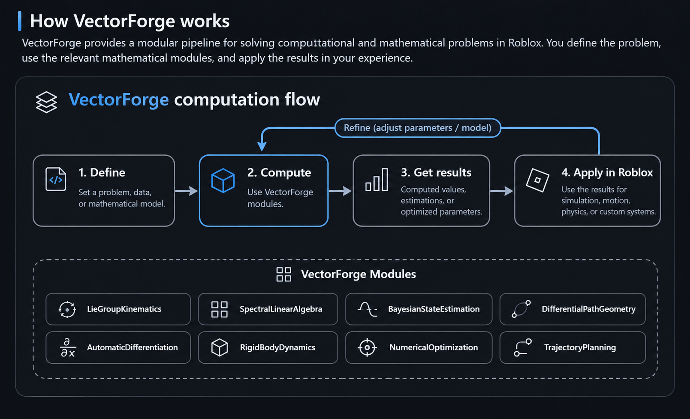

 <div align="center">

# VectorForge


### Toán học tính toán nâng cao cho Roblox Luau

**[English](../../README.md)** · [简体中文](README_zh.md) · [日本語](README_ja.md) · [한국어](README_ko.md) · Tiếng Việt · [ไทย](README_th.md) · [العربية](README_ar.md) · [MA Darija](README_darija.md)

**Khám phá các phương pháp số, tính toán hình học và hệ thống toán học trực tiếp trong Roblox.**

VectorForge là thư viện Luau mang tính thử nghiệm, nghiên cứu cách triển khai toán học tính toán nâng cao, bao gồm động học nhóm Lie, đại số tuyến tính số, ước lượng trạng thái Bayes, hình học vi phân và nhiều lĩnh vực khác.

<p align="center">
  <a href="https://luau.org/"></a>
  <a href="https://www.roblox.com/"></a>
  <a href="LICENSE"></a>
  <a href="#project-status"></a>
  <br>
  
  
  
  
</p>

**[Bắt đầu nhanh](#quick-start) · [Mô-đun cốt lõi](#core-modules) · [Mở rộng khoa học](#scientific-extensions) · [Ví dụ](#examples) · [Thử nghiệm](#experiments) · [Mô phỏng](#simulations) · [Bộ dữ liệu](#datasets) · [Trực quan hóa](#visualizations) · [Tài liệu](#documentation)**

</div>

---

## Tổng quan

Roblox cung cấp môi trường thuận tiện để xây dựng trải nghiệm tương tác, nhưng một số bài toán toán học đòi hỏi các kỹ thuật số chuyên biệt hơn.

VectorForge tìm hiểu cách triển khai những kỹ thuật này trong Luau thông qua tập hợp các mô-đun toán học độc lập. Kho lưu trữ hiện cũng có một lớp nghiên cứu thử nghiệm lớn hơn, bao quát các chủ đề tính toán khoa học như động lực học chất lưu, phương pháp phần tử hữu hạn, cơ học lượng tử, điện từ học, cơ học môi trường liên tục, cơ học quỹ đạo và các quá trình ngẫu nhiên.

Dự án bao gồm những khái niệm thường gặp trong phân tích số, robot học, hình học tính toán, cơ học cổ điển, xác suất và tối ưu hóa.

Thay vì cố gắng thay thế các API tích hợp sẵn của Roblox, VectorForge tập trung vào những phép toán vượt ra ngoài phạm vi lập trình gameplay thông thường.

**Mục tiêu là giúp các kỹ thuật toán học nâng cao dễ tiếp cận, có thể tái sử dụng và sẵn sàng cho việc thử nghiệm trong Roblox.**

<a id="quick-start"></a>
## Bắt đầu nhanh

### Cài đặt

Bạn có thể cài đặt VectorForge thủ công hoặc sử dụng cấu hình dự án Rojo đi kèm.

**Cài đặt thủ công**

1. Mở Roblox Studio.
2. Chuyển đến `ReplicatedStorage`.
3. Tạo một thư mục có tên `VectorForge`.
4. Sao chép các ModuleScript từ `src/VectorForge/` vào thư mục đó.
5. Tạo `ReplicatedStorage/VectorForgeShared` và sao chép các ModuleScript tiện ích dùng chung vào đó.
6. Giữ nguyên tên ModuleScript và cấu trúc thư mục ban đầu.

Cấu trúc trong Explorer sẽ trông như sau:

```text
ReplicatedStorage
└── VectorForge
    ├── LieGroupKinematics
    ├── SpectralLinearAlgebra
    ├── BayesianStateEstimation
    ├── DifferentialPathGeometry
    ├── AutomaticDifferentiation
    ├── RigidBodyDynamics
    ├── NumericalOptimization
    └── TrajectoryPlanning
```

### Rojo

VectorForge có kèm cấu hình dự án Rojo.

Đảm bảo `default.project.json` ánh xạ `src/VectorForge` tới `ReplicatedStorage/VectorForge` và thư mục `VectorForgeShared/` ở thư mục gốc kho lưu trữ tới `ReplicatedStorage/VectorForgeShared`. Hãy kiểm tra tệp dự án trước khi dựa vào ánh xạ này.

Build dự án:

```bash
rojo build default.project.json -o VectorForge.rbxlx
```

[Tài liệu Rojo](https://rojo.space/)

### Cách sử dụng cơ bản

Sau khi cài đặt, hãy tải các mô-đun bằng hàm `require()` của Roblox.

```lua
local ReplicatedStorage = game:GetService("ReplicatedStorage")

local VectorForge = ReplicatedStorage:WaitForChild("VectorForge")
local VectorForgeShared = ReplicatedStorage:WaitForChild("VectorForgeShared")

local SharedConstants = require(VectorForgeShared:WaitForChild("Constants"))
local Lie = require(VectorForge.LieGroupKinematics)
local LinearAlgebra = require(VectorForge.SpectralLinearAlgebra)
local StateEstimation = require(VectorForge.BayesianStateEstimation)
local PathGeometry = require(VectorForge.DifferentialPathGeometry)

local AutomaticDifferentiation =
    require(VectorForge.AutomaticDifferentiation)

local RigidBodyDynamics =
    require(VectorForge.RigidBodyDynamics)

local NumericalOptimization =
    require(VectorForge.NumericalOptimization)

local TrajectoryPlanning =
    require(VectorForge.TrajectoryPlanning)
```

Mỗi mô-đun cung cấp chức năng riêng. Xem [Tài liệu tham khảo API](../../docs/API.md) để biết các thao tác, tham số và giá trị trả về hiện có.

---

<a id="core-modules"></a>
## Mô-đun cốt lõi

VectorForge hiện nghiên cứu tám lĩnh vực toán học.

| Mô-đun | Lĩnh vực toán học | Trọng tâm chính |
|---|---|---|
| `LieGroupKinematics` | Lý thuyết Lie | Phép quay và biến đổi vật rắn |
| `SpectralLinearAlgebra` | Đại số tuyến tính | Phép toán ma trận và bộ giải số |
| `BayesianStateEstimation` | Xác suất | Ước lượng trạng thái và độ bất định |
| `DifferentialPathGeometry` | Hình học vi phân | Đường cong, độ cong và phân tích đường đi |
| `AutomaticDifferentiation` | Giải tích số | Lan truyền đạo hàm |
| `RigidBodyDynamics` | Cơ học cổ điển | Lực, mô-men xoắn và chuyển động vật rắn |
| `NumericalOptimization` | Tối ưu hóa | Tối thiểu hóa bằng phương pháp số |
| `TrajectoryPlanning` | Lập kế hoạch chuyển động | Xây dựng và đánh giá quỹ đạo |

### 1. LieGroupKinematics

**Nhóm Lie · Lý thuyết phép quay · Động học vật rắn**

Các biểu diễn toán học cho phép quay và biến đổi vật rắn trong không gian ba chiều.

Các khái niệm được nghiên cứu:

- Đại số quaternion.
- Các phép toán quay SO(3).
- Các phép biến đổi vật rắn SE(3).
- Ánh xạ mũ và ánh xạ logarit.
- Nội suy tuyến tính cầu (SLERP).
- Hợp thành và nghịch đảo tư thế.
- Biểu diễn twist.

**Ứng dụng tiềm năng**

- Hoạt ảnh thủ tục.
- Điều khiển hướng camera mượt mà.
- Chuyển động lấy cảm hứng từ robot học.
- Nội suy tư thế ba chiều.
- Mô phỏng không gian.

### 2. SpectralLinearAlgebra

**Đại số tuyến tính số · Tính toán ma trận**

Các phương pháp số để thao tác ma trận, giải hệ tuyến tính và thực hiện các phép phân rã toán học.

Các khái niệm được nghiên cứu:

- Nhân ma trận và chuyển vị.
- Phân rã LU.
- Tính định thức.
- Phân rã Cholesky.
- Phân rã QR Householder.
- Xấp xỉ trị riêng của ma trận đối xứng.
- Phương pháp Gradient liên hợp.
- Ước lượng bình phương tối thiểu.
- Giải hệ tuyến tính.

**Ứng dụng tiềm năng**

- Mô phỏng số.
- Hồi quy đa thức.
- Ước lượng tham số.
- Tối ưu hóa toán học.
- Mô hình hóa tính toán.

### 3. BayesianStateEstimation

**Suy luận Bayes · Xác suất · Ước lượng trạng thái**

Các phương pháp ước lượng trạng thái bên trong của một hệ động lực khi quan sát không đầy đủ hoặc chịu ảnh hưởng của độ bất định.

Các khái niệm được nghiên cứu:

- Bộ lọc Kalman mở rộng (EKF).
- Mô hình chuyển trạng thái.
- Mô hình đo lường.
- Lan truyền hiệp phương sai.
- Xấp xỉ Jacobian bằng phương pháp số.
- Hiệu chỉnh phép đo.
- Tính toán innovation.
- Cơ chế kiểm tra ngưỡng đo lường thống kê.

**Ứng dụng tiềm năng**

- Theo dõi vị trí vật thể có nhiễu.
- Dự đoán chuyển động.
- Mô phỏng cảm biến.
- Ước lượng quỹ đạo.
- Mô hình hóa hệ động lực.

### 4. DifferentialPathGeometry

**Hình học vi phân · Phân tích đường cong**

Phân tích toán học các đường cong tham số và đặc tính hình học của chúng.

Các khái niệm được nghiên cứu:

- Nội suy đường cong Hermite.
- Đạo hàm bậc nhất và bậc cao.
- Độ cong và độ xoắn.
- Tích phân độ dài cung bằng phương pháp số.
- Tham số hóa theo độ dài cung.
- Khung Frenet.
- Khung vận chuyển song song.
- Ước lượng điểm gần nhất.
- Tạo quỹ đạo có jerk tối thiểu.

**Ứng dụng tiềm năng**

- Tạo đường đi theo thủ tục.
- Quỹ đạo NPC mượt mà.
- Hệ thống đường ray camera.
- Mô hình hóa quỹ đạo phương tiện.
- Phân tích chuyển động ba chiều.

### 5. AutomaticDifferentiation

**Vi phân tự động · Giải tích số**

Nghiên cứu việc tính đạo hàm bằng cách lan truyền thông tin đạo hàm qua các phép toán số học và biểu thức tính toán được hỗ trợ.

Các khái niệm được nghiên cứu:

- Lan truyền đạo hàm chế độ thuận.
- Đánh giá biểu thức tính toán.
- Theo dõi đạo hàm.
- Phân tích độ nhạy.

**Ứng dụng tiềm năng**

- Tối ưu hóa dựa trên gradient.
- Khớp tham số.
- Phân tích độ nhạy.
- Thử nghiệm toán học khả vi.

### 6. RigidBodyDynamics

**Cơ học cổ điển · Mô phỏng vật lý**

Nghiên cứu mô tả toán học chuyển động vật rắn dưới tác dụng của lực, mô-men xoắn và các đặc tính quán tính.

Các khái niệm được nghiên cứu:

- Chuyển động tịnh tiến và chuyển động góc.
- Biểu diễn khối lượng và quán tính.
- Quan hệ giữa lực và mô-men xoắn.
- Diễn tiến trạng thái vật rắn.
- Động lực học tịnh tiến và quay.

**Ứng dụng tiềm năng**

- Thí nghiệm vật lý.
- Mô hình hóa hệ cơ khí.
- Mô phỏng lấy cảm hứng từ robot học.
- Phân tích chuyển động.

### 7. NumericalOptimization

**Tối ưu hóa số · Tối thiểu hóa lặp**

Nghiên cứu các kỹ thuật số để tìm nghiệm làm tối thiểu hóa hàm mục tiêu theo những giả định và ràng buộc được hỗ trợ.

Các khái niệm được nghiên cứu:

- Đánh giá hàm mục tiêu.
- Cập nhật tham số theo vòng lặp.
- Các khái niệm tối ưu hóa dựa trên gradient.
- Tiêu chí hội tụ.
- Tối thiểu hóa bằng phương pháp số.

**Ứng dụng tiềm năng**

- Ước lượng tham số.
- Khớp đường cong.
- Hiệu chuẩn toán học.
- Thử nghiệm tối ưu hóa.

### 8. TrajectoryPlanning

**Lập kế hoạch chuyển động · Tạo quỹ đạo**

Tập trung vào việc xây dựng và đánh giá đường đi hoặc hồ sơ chuyển động phụ thuộc thời gian giữa các trạng thái hay mục tiêu không gian.

Các khái niệm được nghiên cứu:

- Xây dựng quỹ đạo.
- Đánh giá hồ sơ chuyển động.
- Xử lý điều kiện biên.
- Lập kế hoạch chuyển động mượt.
- Tích hợp với các biểu diễn hình học và động học.

**Ứng dụng tiềm năng**

- Chuyển động NPC.
- Lập kế hoạch đường đi lấy cảm hứng từ robot học.
- Chuyển động camera và vật thể.
- Hoạt ảnh thủ tục.

---

<a id="scientific-extensions"></a>
## Mở rộng khoa học

Kho lưu trữ có một lớp mở rộng thử nghiệm riêng bên cạnh tám Mô-đun cốt lõi ban đầu. Các phần bổ sung được tổ chức theo lĩnh vực khoa học tại thư mục gốc kho lưu trữ. Chúng không nằm trong `src/VectorForge/`, vì vậy thư viện cốt lõi ban đầu vẫn tách biệt với các mô-đun nghiên cứu mở rộng.

Gói mở rộng hiện tại được tổ chức gồm:

- **15 thư mục lĩnh vực khoa học**
- **300 mô-đun theo lĩnh vực**, mỗi lĩnh vực có 20 mô-đun
- **30 mô-đun hỗ trợ theo lĩnh vực**, mỗi thư mục lĩnh vực có thêm hai tệp ở thư mục gốc
- **7 mô-đun tiện ích dùng chung** trong `VectorForgeShared/`
- **10 ví dụ mô phỏng có tên riêng**
- **10 ví dụ về bất biến số và kiểm định**

Tổng cộng có **357 tệp Lua** trong gói mở rộng, không tính README này. Đây là số lượng tệp trong kho lưu trữ, không có nghĩa mọi mô-đun đều là bộ giải khoa học đã được xác thực đầy đủ.

### Các lĩnh vực khoa học

| Thư mục lĩnh vực | Các hướng nghiên cứu chính |
|---|---|
| `fluid-dynamics/` | Mô hình dòng chảy, phương trình động lượng, vận chuyển và nền tảng bộ giải chất lưu |
| `control-systems/` | Mô hình không gian trạng thái, điều khiển phản hồi, bộ quan sát và phân tích ổn định |
| `finite-element-methods/` | Công thức phần tử, dữ liệu vật liệu, tích phân số và khái niệm lắp ráp |
| `signal-processing/` | Biến đổi rời rạc, lọc, tích chập và lý thuyết lấy mẫu |
| `tensor-calculus/` | Lưu trữ tensor, phép co, metric và phép toán vi phân |
| `differential-equations/` | Tích phân bài toán giá trị ban đầu, bài toán biên và bước tiến số |
| `computational-geometry/` | Đường cong tham số, độ cong, vị từ hình học và khái niệm lưới |
| `optimization-methods/` | Phương pháp gradient, tìm kiếm đường, hàm mục tiêu bình phương tối thiểu và quy tắc dừng |
| `quantum-mechanics/` | Biểu diễn hàm sóng, mật độ xác suất và nền tảng mô hình lượng tử |
| `thermodynamics/` | Phương trình trạng thái, tính chất nhiệt, năng lượng và chuyển đổi nhiệt động lực học |
| `electromagnetics/` | Trường điện từ, lực Lorentz, hằng số và lấy mẫu trường |
| `orbital-mechanics/` | Chuyển động hai vật thể, tham số quỹ đạo và hằng số thiên văn động lực học |
| `rigid-body-physics/` | Quán tính, mô-men động lượng, thiết lập tiếp xúc và động lực học quay |
| `continuum-mechanics/` | Thước đo biến dạng, dữ liệu vật liệu đàn hồi và nền tảng mô hình cấu thành |
| `stochastic-processes/` | Quá trình ngẫu nhiên, bước tiến ngẫu nhiên và phân phối xác suất |

### Bố cục thư mục

Mỗi lĩnh vực khoa học có ba thư mục con:

- `analysis/` — các mô-đun và phép tính phục vụ phân tích
- `models/` — biểu diễn mô hình và trạng thái
- `solvers/` — quy trình số và các mô-đun bộ giải

Mỗi thư mục lĩnh vực còn có hai mô-đun hỗ trợ nằm trực tiếp ở thư mục gốc. Chúng cung cấp cấu hình, dữ liệu vật liệu, hằng số, quy tắc lấy mẫu hoặc hàm trợ giúp riêng cho lĩnh vực đó.

Các tiện ích dùng chung nằm trong thư mục gốc duy nhất `VectorForgeShared/`. Trong Roblox Studio, thư mục này phải nằm dưới `ReplicatedStorage/VectorForgeShared`:

| Mô-đun | Trách nhiệm |
|---|---|
| `Constants.lua` | Các hằng số vật lý và toán học dùng chung |
| `CoreRegistry.lua` | Đăng ký và tra cứu tường minh các Mô-đun cốt lõi VectorForge hiện có |
| `EquationCatalog.lua` | Danh mục ngắn gọn các phương trình chi phối dùng làm tài liệu tham khảo |
| `LinearAlgebra.lua` | Các phép toán ma trận cơ bản trên mảng hàng |
| `NumericalGuards.lua` | Kiểm tra giá trị hữu hạn, giới hạn giá trị và phép chia an toàn |
| `NumericalKernels.lua` | Các lõi tính toán số cấp thấp dùng chung |
| `SimulationClock.lua` | Định thời mô phỏng với bước cố định |

### Tích hợp với các Mô-đun cốt lõi

Các mô-đun mở rộng được giữ tách biệt khỏi `src/VectorForge/`. `VectorForgeShared/CoreRegistry.lua` cung cấp cơ chế tiêm phụ thuộc để một tập lệnh bootstrap có thể đăng ký các phiên bản Mô-đun cốt lõi thực tế.

Registry không tự đoán đường dẫn mô-đun và cũng không tự động tải các Mô-đun cốt lõi. Chỉ đăng ký những mô-đun thực sự tồn tại trong dự án và có API công khai đã được kiểm tra.

**Quan trọng:** chỉ sử dụng một thư mục dùng chung tên `VectorForgeShared`. Không giữ các bản sao song song trong `shared`, `Shared` và `VectorForgeShared`. Các mô-đun lĩnh vực và tập lệnh bootstrap phải tham chiếu cùng một đối tượng `ReplicatedStorage/VectorForgeShared`.

Ví dụ:

```lua
local ReplicatedStorage = game:GetService("ReplicatedStorage")
local Shared = ReplicatedStorage:WaitForChild("VectorForgeShared")
local CoreRegistry = require(Shared:WaitForChild("CoreRegistry"))

CoreRegistry.Configure({
    SpectralLinearAlgebra = require(path.to.src.VectorForge.SpectralLinearAlgebra),
    AutomaticDifferentiation = require(path.to.src.VectorForge.AutomaticDifferentiation),
    BayesianStateEstimation = require(path.to.src.VectorForge.BayesianStateEstimation),
})

local LinearAlgebraCore = CoreRegistry.Require("SpectralLinearAlgebra")
```

Mã nguồn mở rộng biểu diễn trạng thái toán học bằng mảng số và không phụ thuộc trực tiếp vào kiểu dữ liệu không gian của Roblox. Điều này không có nghĩa mọi thuật toán đều là bộ giải vật lý hoàn chỉnh hoặc mọi mô-đun đã được xác thực bằng một bản triển khai tham chiếu.

### Ví dụ và tệp kiểm định

Thư mục `examples/` chứa các nghiên cứu số được đặt tên riêng, bao gồm đáp ứng bộ dao động tắt dần, diễn tiến trạng thái ghép nối, đáp ứng phi tuyến, suy giảm năng lượng, độ ổn định tích phân và diễn tiến trạng thái trong khoảng thời gian dài.

Các phần mở rộng trong `tests/` có thêm những kiểm tra bất biến số nhỏ. Chúng là điểm khởi đầu hữu ích cho kiểm thử hồi quy, nhưng không thay thế các chuẩn giải tích, kiểm tra thứ nguyên, nghiên cứu hội tụ hoặc xác minh bằng dữ liệu khoa học đáng tin cậy.

### Trạng thái nghiên cứu và sử dụng thực tế

Các phần mở rộng khoa học là nền tảng nghiên cứu mang tính thử nghiệm. Một số mô-đun cung cấp các thủ tục số có thể tái sử dụng và phép tính theo lĩnh vực; những mô-đun khác vẫn cần rời rạc hóa theo bài toán, điều kiện biên, định luật cấu thành, đơn vị và chiến lược bộ giải cụ thể.

Trước khi sử dụng phần mở rộng trong trải nghiệm thực tế:

1. Kiểm tra đầu vào, đầu ra, thứ nguyên và đơn vị của mô-đun.
2. Xác minh các giả định và điều kiện biên.
3. So sánh kết quả với nghiệm giải tích hoặc dữ liệu tham chiếu đáng tin cậy.
4. Kiểm tra hội tụ và ổn định số trên các phạm vi đầu vào đại diện.
5. Đo hiệu năng thực thi trong Roblox Studio.
6. Xác minh mọi tích hợp Mô-đun cốt lõi dựa trên API công khai thực tế.

Các phần bổ sung này mở rộng phạm vi nghiên cứu của kho lưu trữ; chúng không thay đổi các bước cài đặt của tám Mô-đun cốt lõi ban đầu.

---

## VectorForge hoạt động như thế nào

VectorForge cung cấp một tập hợp các mô-đun toán học độc lập có thể sử dụng trong trải nghiệm Roblox. Bạn xác định bài toán hoặc mô hình toán học, chọn mô-đun phù hợp, cung cấp đầu vào cần thiết và sử dụng kết quả trả về trong hệ thống của mình.

Sơ đồ bên dưới đưa ra cái nhìn tổng quan về quy trình này. Đây là lời giải thích mang tính khái niệm về cách nhà phát triển có thể sử dụng thư viện; nó không hàm ý rằng tất cả mô-đun được kết nối tự động hoặc VectorForge chạy một quy trình cố định duy nhất.



## Cách các thành phần VectorForge kết hợp

Các mô-đun được tổ chức theo những trách nhiệm toán học riêng biệt.


Cấu trúc mô-đun này nhằm hỗ trợ:

- Các thành phần toán học độc lập.
- Các triển khai có thể tái sử dụng.
- Phân tách trách nhiệm rõ ràng.
- Kiểm thử và bảo trì dễ dàng hơn.
- Mở rộng toán học trong tương lai.

Xem [ARCHITECTURE.md](../../docs/ARCHITECTURE.md) để biết thêm chi tiết.

---

<a id="examples"></a>
## Ví dụ

Thư mục `examples/` chứa các bản minh họa độc lập cho thấy cách sử dụng một số mô-đun VectorForge trong Roblox.

| Ví dụ | Mô tả |
|---|---|
| Nội suy tư thế | Nội suy giữa các tư thế vật rắn |
| Đường đi vi phân | Lấy mẫu đường cong và di chuyển dọc theo đường đi hình học |
| Theo dõi chuyển động Bayes | Ước lượng bằng các quan sát vị trí có nhiễu |
| Hồi quy bình phương tối thiểu | Khớp đa thức bằng đại số tuyến tính số |
| Minh họa tích phân | Các minh họa liên quan đến bộ mô-đun mở rộng |

Mỗi ví dụ được thiết kế để có thể tự tìm hiểu và làm điểm khởi đầu cho các thử nghiệm tiếp theo.

Xem [examples/README.md](../../examples/README.md).

<a id="experiments"></a>
## Thử nghiệm

Thư mục `experiments/` chứa các tập lệnh khám phá để trực quan hóa khái niệm toán học và khảo sát những ứng dụng tiềm năng.

| Thử nghiệm | Mô tả |
|---|---|
| Cơ học thiên thể | Trực quan hóa giáo dục về chuyển động hấp dẫn đã giản lược |
| Mô phỏng quỹ đạo | Khảo sát quỹ đạo bằng mô hình cơ học giản lược |
| Trực quan hóa Kalman | Trực quan hóa quan sát có nhiễu và ước lượng được làm trơn |
| Phòng thí nghiệm quỹ đạo | Xây dựng quỹ đạo mang tính thử nghiệm |
| Phòng thí nghiệm ổn định số | So sánh các phương pháp cộng số |

Các thử nghiệm này phục vụ mục đích khám phá, không phải mô phỏng sẵn sàng cho môi trường thực tế.

Một số bản minh họa sử dụng phép tính tham chiếu đã giản lược hoặc bộ chuyển đổi trực quan hóa. Ví dụ, các bản minh họa thiên thể và quỹ đạo dùng mô hình Newton đơn giản hóa, không phải thuyết tương đối rộng. Phần trực quan hóa Kalman là minh họa làm trơn giản lược, không phải triển khai EKF hoàn chỉnh.

Xem [experiments/README.md](../../experiments/README.md).


<a id="simulations"></a>
## Mô phỏng

Thư mục `simulations/` lưu một vài mô hình số độc lập. Chúng hữu ích khi kiểm tra cách một hệ thống thay đổi theo thời gian mà không gắn phép tính với một cảnh Roblox.

Các tập lệnh hiện tại bao gồm hai bài toán khác nhau:

| Tập lệnh | Mô hình được mô phỏng |
|---|---|
| `TwoBodyOrbit.lua` | Chuyển động tương đối theo mô hình hấp dẫn Newton giản lược |
| `DampedOscillator.lua` | Một khối lượng gắn với lò xo có giảm chấn tuyến tính |

Cả hai đều sử dụng một bước Runge–Kutta bậc bốn. Bên gọi cung cấp trạng thái ban đầu và bước thời gian, vì vậy đồng hồ mô phỏng và điều kiện dừng vẫn do bên gọi kiểm soát.

Ví dụ quỹ đạo dùng đơn vị SI: mét, mét trên giây, giây và tham số hấp dẫn có đơn vị mét khối trên giây bình phương. Bộ dao động dùng mét, kilôgam, giây, newton trên mét và newton-giây trên mét.

Đây là những mô hình có quy mô nhỏ có chủ ý. Tập lệnh quỹ đạo không tính đến các thiên thể bổ sung, lực cản khí quyển, va chạm hoặc hiệu ứng tương đối tính. Bộ dao động giả định lò xo tuyến tính và giảm chấn nhớt tuyến tính. Không mô hình nào nên được xem là một công cụ vật lý dùng trong môi trường thực tế.

Xem [simulations/README.md](../../simulations/README.md) để biết cách thiết lập, tham số và giới hạn của từng tập lệnh.

<a id="datasets"></a>
## Bộ dữ liệu

Thư mục `datasets/` lưu các giá trị tham chiếu và dữ liệu mẫu được tập lệnh cũng như thử nghiệm của dự án sử dụng. Tách dữ liệu khỏi thuật toán giúp dễ tái sử dụng cùng đầu vào và biết chính xác bản minh họa đang sử dụng dữ liệu nào.

| Tệp | Nội dung |
|---|---|
| `PhysicalConstants.lua` | Một tập hợp nhỏ các hằng số vật lý theo đơn vị SI |
| `SolarSystem.lua` | Khối lượng gần đúng, bán trục lớn trung bình, chu kỳ quỹ đạo và tham số hấp dẫn suy ra của một số hành tinh |
| `MotionSamples.lua` | Một chuỗi ngắn các quan sát vị trí 2D tổng hợp có dấu thời gian |

Các giá trị hành tinh là dữ liệu tham chiếu đã làm tròn, không phải lịch thiên văn có độ chính xác cao. Các mẫu chuyển động là ví dụ được tạo ra, không phải số đo từ cảm biến thực. Sự khác biệt này rất quan trọng khi so sánh số hoặc thực hiện thử nghiệm ước lượng trạng thái.

Khi thêm dữ liệu, hãy ghi rõ đơn vị và cho biết đó là dữ liệu đo được, dữ liệu tổng hợp hay giá trị gần đúng. Điều này giúp tránh nhầm lẫn về sau.

Xem [datasets/README.md](../../datasets/README.md) để biết quy ước dữ liệu và ví dụ sử dụng.

<a id="visualizations"></a>
## Trực quan hóa

Thư mục `visualizations/` chứa các tiện ích Roblox nhỏ để hiển thị kết quả tính toán trong cảnh 3D. Ý tưởng là tách phép toán khỏi phần vẽ: một mô phỏng hoặc thuật toán tạo ra các giá trị, còn bộ kết xuất chuyển chúng thành hình ảnh để bạn kiểm tra.

| Mô-đun | Nội dung hiển thị |
|---|---|
| `TrajectoryRenderer.lua` | Một chuỗi điểm `Vector3` được nối bằng các đoạn đã neo |
| `VectorFieldRenderer.lua` | Các mẫu vector được hiển thị dưới dạng chỉ báo hướng trong không gian 3D |

Cả hai mô-đun đều tạo một `Model` bên dưới đối tượng cha do bạn cung cấp. Các Part được neo và không có va chạm. Khi hoàn tất trực quan hóa, hãy hủy model được trả về để dọn các instance đã tạo.

Các tiện ích này dành cho gỡ lỗi và minh họa nhỏ, không dành cho biểu đồ khoa học dày đặc. Số lượng Part lớn có thể tốn tài nguyên, đặc biệt khi chúng được nhân bản hoặc dựng lại thường xuyên. Hãy giữ số mẫu ở mức hợp lý và đo hiệu năng trong Studio.

Xem [visualizations/README.md](../../visualizations/README.md) để biết ví dụ và tùy chọn bộ kết xuất.

## Đánh giá hiệu năng

Thư mục `benchmarks/` chứa các tập lệnh theo khối lượng công việc để khảo sát hiệu năng của những phép toán toán học được chọn.

Các lĩnh vực đánh giá hiện tại bao gồm:

- Tính toán ma trận.
- Tối ưu hóa số.
- Hình học vi phân.
- Ước lượng trạng thái.
- Tiện ích đánh giá dùng chung.

Kết quả đánh giá có thể thay đổi tùy theo phần cứng, điều kiện chạy, kích thước đầu vào và chi tiết triển khai.

Một số tập lệnh cần bộ chuyển đổi để kết nối callback của khối lượng công việc với API công khai đã được xác minh. Việc các tập lệnh này tồn tại không có nghĩa là đã hoàn tất đo hiệu năng toàn diện.

Tài liệu:

- [Hướng dẫn đánh giá hiệu năng](../../docs/BENCHMARKING.md)
- [Tập lệnh đánh giá](../../benchmarks/README.md)

## Nền tảng toán học

VectorForge dựa trên một số ngành toán học.

| Lĩnh vực | Khái niệm |
|---|---|
| Đại số tuyến tính | Phép toán ma trận, phân rã, trị riêng |
| Hình học vi phân | Độ cong, độ xoắn, khung tiếp tuyến và pháp tuyến |
| Lý thuyết Lie | SO(3), SE(3), ánh xạ mũ và logarit |
| Phân tích số | Xấp xỉ, tích phân, bộ giải lặp |
| Lý thuyết xác suất | Ước lượng Bayes và độ bất định |
| Tối ưu hóa | Ước lượng bình phương tối thiểu và tối thiểu hóa lặp |
| Xử lý tín hiệu | Phân tích miền tần số và biến đổi số |

Để biết thêm giải thích, xem [MATHEMATICS.md](../../docs/MATHEMATICS.md).

## Ghi chú nghiên cứu

Thư mục `research/` chứa các ghi chú toán học hỗ trợ và tài liệu khám phá.

Các chủ đề hiện tại bao gồm:

- Toán học nhóm Lie và biến đổi không gian.
- Phương pháp số và tính ổn định tính toán.
- Ước lượng trạng thái Bayes.
- Các thuật toán và mở rộng toán học có thể phát triển trong tương lai.

Những ghi chú này ghi lại các cân nhắc lý thuyết và cách tiếp cận khả thi trong quá trình phát triển. Đây là tài liệu bổ trợ, không phải xác minh toán học chính thức.

Xem [research/README.md](../../research/README.md).

---

## Kiểm thử

VectorForge có các tập lệnh kiểm thử hồi quy và kiểm thử toàn diện bao phủ những thao tác quan trọng trong các mô-đun.

Các lĩnh vực kiểm thử hiện tại bao gồm:

- Phép toán quaternion và biến đổi vật rắn.
- Nhân và phân rã ma trận.
- Giải hệ tuyến tính.
- Tính trị riêng.
- Tối ưu hóa số.
- Các thao tác của bộ lọc Kalman mở rộng.
- Đánh giá đường cong và các thuộc tính vi phân.
- Tính độ dài cung.
- Điều kiện biên quỹ đạo.
- Vi phân tự động.
- Động lực học vật rắn và lập kế hoạch quỹ đạo.

### Chạy kiểm thử

1. Cài đặt các mô-đun VectorForge trong `ReplicatedStorage/VectorForge`.
2. Đặt trình chạy kiểm thử trong `ServerScriptService`.
3. Bắt đầu phiên Play trong Roblox Studio.
4. Mở cửa sổ Output.
5. Kiểm tra kết quả kiểm thử.

Bộ kiểm thử cung cấp nền tảng ban đầu cho kiểm thử hồi quy. Nó không cấu thành xác minh toán học chính thức và cũng không bảo đảm tính ổn định số.

Xem [tests/README.md](../../tests/README.md).

## Lưu ý về hiệu năng

Các thuật toán số có thể trở nên tốn kém tùy theo kích thước đầu vào, số vòng lặp và tần suất thực thi.

Khi sử dụng VectorForge, hãy cân nhắc:

- Tránh các phép phân rã ma trận không cần thiết.
- Tái sử dụng kết quả đã tính khi đầu vào không thay đổi.
- Hạn chế phép toán tốn kém bên trong các vòng lặp phụ thuộc khung hình.
- Chọn dung sai bộ giải và giới hạn vòng lặp phù hợp.
- Đo hiệu năng bằng khối lượng công việc đại diện.
- Khi phù hợp, tách phép tính có thẩm quyền phía máy chủ khỏi phép tính trực quan hóa phía máy khách.

Triển khai hiện tại vẫn chưa được đánh giá hiệu năng một cách toàn diện.

## Cấu trúc kho lưu trữ

```text
VectorForge/
├── benchmarks/
├── computational-research/
├── datasets/
├── docs/
├── examples/
│   └── server/
├── experiments/
├── research/
├── simulations/
├── visualizations/
│
├── fluid-dynamics/
│   ├── analysis/
│   ├── models/
│   ├── solvers/
│   └── domain support modules
├── control-systems/
│   ├── analysis/
│   ├── models/
│   ├── solvers/
│   └── domain support modules
├── finite-element-methods/
├── signal-processing/
├── tensor-calculus/
├── differential-equations/
├── computational-geometry/
├── optimization-methods/
├── quantum-mechanics/
├── thermodynamics/
├── electromagnetics/
├── orbital-mechanics/
├── rigid-body-physics/
├── continuum-mechanics/
├── stochastic-processes/
├── VectorForgeShared/
│   ├── Constants.lua
│   ├── CoreRegistry.lua
│   ├── EquationCatalog.lua
│   ├── LinearAlgebra.lua
│   ├── NumericalGuards.lua
│   ├── NumericalKernels.lua
│   └── SimulationClock.lua
│
├── src/
│   └── VectorForge/
│       ├── LieGroupKinematics
│       ├── SpectralLinearAlgebra
│       ├── BayesianStateEstimation
│       ├── DifferentialPathGeometry
│       ├── AutomaticDifferentiation
│       ├── RigidBodyDynamics
│       ├── NumericalOptimization
│       └── TrajectoryPlanning
├── tests/
├── .gitignore
├── CHANGELOG.md
├── CONTRIBUTING.md
├── default.project.json
├── LICENSE
├── package.json
├── package-lock.json
└── README.md
```

| Thư mục | Trách nhiệm |
|---|---|
| `src/` | Các mô-đun cốt lõi VectorForge cho Roblox Luau |
| `docs/` | Tài liệu kỹ thuật và giải thích toán học |
| `examples/` | Minh họa thực tế cho các mô-đun cốt lõi |
| `tests/` | Kiểm thử hồi quy và kiểm tra số |
| `benchmarks/` | Đo hiệu năng theo khối lượng công việc |
| `experiments/` | Tập lệnh và minh họa khám phá |
| `research/` | Ghi chú và ý tưởng toán học đang được nghiên cứu |
| `computational-research/` | Tập lệnh toán học nâng cao và khoa học độc lập |
| `simulations/` | Mô hình số tiến triển theo bước thời gian |
| `datasets/` | Hằng số tham chiếu và dữ liệu đầu vào mẫu |
| `visualizations/` | Tiện ích Roblox để hiển thị kết quả số |
| Các thư mục lĩnh vực khoa học | Mô-đun thử nghiệm cho vật lý, kỹ thuật, hình học, tối ưu hóa và tính toán khoa học |
| `VectorForgeShared/` | Một lớp tiện ích dùng chung và đăng ký Mô-đun cốt lõi tường minh |

---

## Câu hỏi thường gặp

<details>
<summary><strong>VectorForge có thay thế Roblox Vector3 hoặc CFrame không?</strong></summary>

Không. VectorForge nghiên cứu các phép toán vượt xa tiện ích vector và biến đổi thông thường. API tích hợp của Roblox vẫn hữu ích và phù hợp với nhiều tác vụ phát triển hằng ngày.

</details>

<details>
<summary><strong>VectorForge đã sẵn sàng cho môi trường thực tế chưa?</strong></summary>

Chưa. Đây là dự án thử nghiệm. API, hành vi số, hiệu năng và chi tiết triển khai có thể thay đổi.

</details>

<details>
<summary><strong>Tôi có thể sử dụng từng mô-đun riêng lẻ không?</strong></summary>

Thư viện được tổ chức thành các mô-đun toán học riêng biệt, được thiết kế để hoạt động độc lập khi phù hợp. Hãy xem tài liệu API để biết chức năng và phụ thuộc hiện có.

</details>

<details>
<summary><strong>Các thư mục simulations, datasets và visualizations dùng để làm gì?</strong></summary>

Chúng nằm cạnh thư viện cốt lõi. `simulations/` chứa các mô hình nhỏ chạy theo bước thời gian, `datasets/` lưu dữ liệu tham chiếu và đầu vào mẫu, còn `visualizations/` chứa tiện ích Roblox để hiển thị kết quả. Đây là tài liệu hỗ trợ và không làm thay đổi cách cài đặt các mô-đun cốt lõi.

</details>

<details>
<summary><strong>VectorForge có bao gồm đánh giá hiệu năng không?</strong></summary>

Dự án có các tập lệnh đánh giá cho một số khối lượng công việc được chọn. Một số cần bộ chuyển đổi và hiện chưa có kết quả đánh giá toàn diện.

</details>

<details>
<summary><strong>Tôi có thể tìm ví dụ sử dụng ở đâu?</strong></summary>

Xem thư mục `examples/` và [examples/README.md](../../examples/README.md). Các thư mục `simulations/` và `visualizations/` cũng có những bản minh họa tập trung.

</details>

<details>
<summary><strong>Tôi có thể đóng góp không?</strong></summary>

Hoan nghênh phản hồi kỹ thuật, báo lỗi, đề xuất và đóng góp. Vui lòng xem hướng dẫn đóng góp trước khi gửi thay đổi.

</details>

---


<details>
<summary><strong>Các thư mục lĩnh vực khoa học có thuộc những Mô-đun cốt lõi ban đầu không?</strong></summary>

Đây là một lớp mở rộng thử nghiệm riêng tại thư mục gốc kho lưu trữ. Tám Mô-đun cốt lõi ban đầu vẫn nằm trong `src/VectorForge/`. Các phần mở rộng có thể được phát triển và kiểm thử độc lập, với các phụ thuộc Mô-đun cốt lõi tùy chọn được đăng ký thông qua `VectorForgeShared/CoreRegistry.lua`.

</details>

<details>
<summary><strong>Tất cả mô-đun mở rộng khoa học đã hoàn chỉnh và được kiểm định chưa?</strong></summary>

Không. Các phần mở rộng là nền tảng nghiên cứu. Trước khi sử dụng trong môi trường thực tế, cần kiểm tra giả định toán học, đơn vị, điều kiện biên, tính hội tụ, độ ổn định số và khả năng tương thích với API thực tế của các Mô-đun cốt lõi ở từng mô-đun.

</details>

<a id="documentation"></a>
## Tài liệu

Thư mục `docs/` chứa các tài liệu tham khảo kỹ thuật cho VectorForge.

- [Tài liệu tham khảo API](../../docs/API.md) — Các thao tác và giao diện mô-đun hiện có.
- [Kiến trúc](../../docs/ARCHITECTURE.md) — Tổ chức và thiết kế mô-đun.
- [Toán học](../../docs/MATHEMATICS.md) — Các khái niệm và nền tảng toán học.
- [Kiểm định số](../../docs/NUMERICAL_VALIDATION.md) — Các lưu ý về kiểm định.
- [Đánh giá hiệu năng](../../docs/BENCHMARKING.md) — Phương pháp và hướng dẫn đánh giá.
- [Quyết định thiết kế](../../docs/DESIGN_DECISIONS.md) — Các cân nhắc thiết kế dự án.
- [Bảng thuật ngữ](../../docs/GLOSSARY.md) — Thuật ngữ toán học và kỹ thuật.
- [Mô phỏng](../../simulations/README.md) — Mô hình số và chi tiết tích phân.
- [Bộ dữ liệu](../../datasets/README.md) — Giá trị tham chiếu, đơn vị và dữ liệu mẫu.
- [Trực quan hóa](../../visualizations/README.md) — Tiện ích kết xuất cảnh và cách sử dụng.

Các thư mục mở rộng khoa học hiện mô tả mục đích của mô-đun trong phần chú thích ở mã nguồn và tổng quan kho lưu trữ này. Cần bổ sung tài liệu tham khảo API theo từng lĩnh vực và báo cáo kiểm định khi các mô-đun được xác minh.

## Đóng góp

Hoan nghênh đóng góp, phản hồi kỹ thuật, báo lỗi và đề xuất.

Nếu phát hiện vấn đề, vui lòng cung cấp:

- Mô-đun bị ảnh hưởng.
- Ví dụ tối thiểu có thể tái hiện lỗi.
- Hành vi toán học mong đợi.
- Hành vi thực tế quan sát được.
- Lỗi liên quan trong Roblox Studio Output.

Xem [CONTRIBUTING.md](../../CONTRIBUTING.md) trước khi gửi pull request.

## Trạng thái phát triển

VectorForge vẫn đang trong giai đoạn thử nghiệm tích cực. Các hướng phát triển tiềm năng trong tương lai bao gồm:

**Cải tiến số**
- Bổ sung phương pháp phân rã ma trận.
- Cải thiện độ ổn định số.
- Xử lý đầu vào suy biến tốt hơn.
- Bổ sung các bộ giải lặp.
- Cải thiện chẩn đoán hội tụ.

**Mở rộng toán học**
- Bổ sung kỹ thuật xác suất và ước lượng.
- Thêm tiện ích biến đổi hình học.
- Phương pháp tích phân số.
- Bổ sung phép toán hình học vi phân.

**Trải nghiệm nhà phát triển**
- Mở rộng tài liệu API.
- Thêm ví dụ thực tế.
- Bổ sung kiểm thử tự động.
- Đánh giá hiệu năng.
- Cải thiện xử lý lỗi và kiểm định.

Đây là các định hướng phát triển, không phải cam kết chắc chắn về lịch phát hành.

## Giấy phép

VectorForge được phân phối theo Giấy phép MIT.

Xem [LICENSE](../../LICENSE) để đọc toàn văn giấy phép.

---

<div align="center">

**VectorForge**

*Khám phá toán học tính toán trong Roblox Luau.*

</div>
